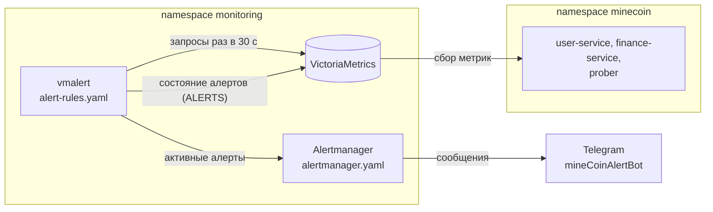
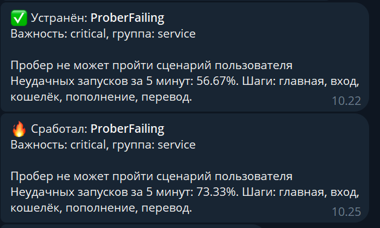
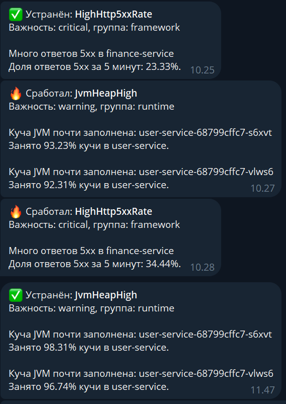
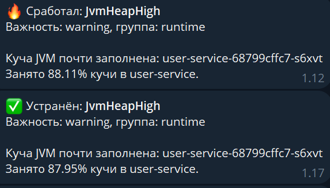
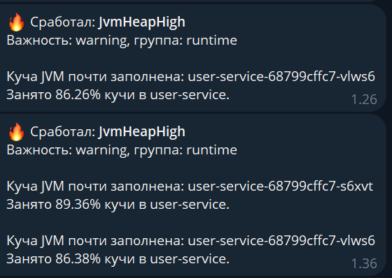
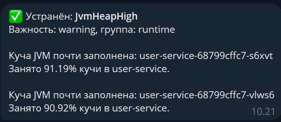

# Отчёт: алерты для MineCoin

Работа продолжает [отчёт по SLI/SLO](../slo/Отчёт_slo.md): метрики, которые VictoriaMetrics собирает с сервисов и
пробера, теперь проверяются правилами, и при нарушении приходит уведомление в Telegram.

В namespace `monitoring` добавлены два компонента:

- **vmalert** - каждые 30 секунд выполняет правила к VictoriaMetrics и решает, какие алерты
  активны;
- **Alertmanager** - получает активные алерты от vmalert, группирует их и отправляет сообщения боту Telegram.



## 1. Какие алерты нужны

Алерты делятся по тому, что они ловят:

- **симптом** - что-то уже пошло не так, и пользователю плохо: не проходит вход, сервис отвечает ошибками. Такие алерты получают
  важность `critical`;
- **причина или насыщение** - сам сервис работает, но появилась будущая проблема: заканчивается память, кто-то
  подбирает пароль. Важность `warning`.

Каждый алерт должен требовать действия. Поэтому пороги подобраны так, чтобы в штатном режиме алерт молчал, а условие
должно держаться некоторое время, чтобы не было ложных срабатываний.

Рассмотренные кандидаты и выбор:

| Уровень                 | Кандидаты                                                                    | Выбран             |
|-------------------------|------------------------------------------------------------------------------|--------------------|
| Сервис (`minecoin_*`)   | пробер не проходит; подбор пароля; переводы без `user-service`; крупные суммы | `ProberFailing`, `LoginBruteForce` |
| Фреймворк (Spring)      | доля 5xx; медленные ответы; ошибки в логах; очередь к пулу БД; потоки Tomcat | `HighHttp5xxRate`  |
| Рантайм (JVM)           | заполнение кучи; время в GC; CPU; перезапуск                                 | `JvmHeapHigh`      |

Почему именно эти:

- **`ProberFailing`** - пробер проверяет работает ли приложение, если не работает, поднимаем алерт.
- **`LoginBruteForce`** - ловит то, чего не видят остальные: при подборе пароля сервис работает штатно и отвечает
  `401`, ошибок 5xx нет.
- **`HighHttp5xxRate`** - показывает, какой именно сервис ломается (метка `application`), и связан с SLI-1 из
  прошлого ДЗ.
- **`JvmHeapHigh`** - должен предупредить пока не стало слишком поздно: при нехватке кучи сервис начнёт отвечать ошибками или будет убит.

Метрики `http_server_requests_seconds` и `jvm_memory_*` создаёт не код проекта, а Spring Boot Actuator и Micrometer,
поэтому они отнесены к фреймворку и рантайму. Алерты на сервис построены на собственных метриках `minecoin_*`.

## 2. Правила

Файл [`alert-rules.yaml`](alert-rules.yaml) - три группы по уровням, у каждого правила метки `severity` (важность) и
`category` (уровень) и тексты `summary` и `description` для уведомления.

### Сервис: `ProberFailing`

```yaml
expr: |
  sum(rate(minecoin_prober_runs_total{result="failure"}[5m]))
    / sum(rate(minecoin_prober_runs_total[5m])) > 0.2
for: 2m
severity: critical
```

Пробер запускается каждые 10 секунд, за 5 минут - около 30 прогонов. Порог - доля неудачных, а не "хотя бы одна
неудача": один случайный сбой дает 3 % и не кидает алерт. При 20 % сбоев - 6 прогонов из 30 - пользователи
замечают проблему. `for: 2m` отсекает короткие всплески, например при перезапуске пода.

### Сервис: `LoginBruteForce`

```yaml
expr: sum(increase(minecoin_auth_logins_total{result="invalid_credentials"}[5m])) > 20
for: 1m
severity: warning
```

В норме неудачных входов почти нет: пробер входит с правильным паролем, человек ошибается 1–3 раза. 20 неудачных
входов за 5 минут это попытка взлома на нашем масштабе. Важность `warning`: сервис работает, но нужно посмотреть логи `user-service`, кого
пытаются взломать. Метки с именем пользователя или IP у метрики нет, поэтому алерт считает все неудачные входы вместе.

### Фреймворк: `HighHttp5xxRate`

```yaml
expr: |
  sum by (application) (rate(http_server_requests_seconds_count{namespace="minecoin", status=~"5.."}[5m]))
    / sum by (application) (rate(http_server_requests_seconds_count{namespace="minecoin"}[5m])) > 0.05
for: 5m
severity: critical
```

SLO по доступности API (SLI-1) - 99,5 %, бюджет ошибок 0,5 %. Доля 5xx 5 % тратит бюджет в 10 раз быстрее
допустимого: месячный бюджет кончится за 3 дня. Трафик небольшой (~0,3 запроса в секунду), поэтому нужен `for: 5m`:
иначе пара ошибок подряд даст ложное срабатывание. Группировка по `application` показывает в сообщении, какой
сервис сломан.

### Рантайм: `JvmHeapHigh`

```yaml
expr: |
  sum by (application, pod) (jvm_memory_used_bytes{area="heap"})
    / sum by (application, pod) (jvm_memory_max_bytes{area="heap"}) > 0.85
for: 5m
keep_firing_for: 5m
severity: warning
```

Куча сервиса - ~371 МиБ (75 % от лимита контейнера 512 МиБ), в обычной работе занято 10–15 %. Больше 85 % в течение
5 минут значит, что сборщик мусора не может освободить память: скоро будет `OutOfMemoryError`. Алерт отдельный для
каждого пода.

Занятая куча меняется пилой: растет до сборки мусора и резко падает после нее. На минимуме пилы значение ненадолго
опускается ниже порога, и без `keep_firing_for` алерт закрывался и через несколько минут срабатывал снова (так было
при проверке, раздел 5). `keep_firing_for: 5m` держит алерт активным, пока провалы короче 5 минут.

## 3. Alertmanager и Telegram

Файл [`alertmanager.yaml`](alertmanager.yaml):

- все алерты идут в один получатель `telegram`;
- `group_by: [alertname, application]` - алерты одного типа из одного сервиса приходят одним сообщением: при
  `JvmHeapHigh` на двух подах `user-service` пришло одно сообщение с обоими подами;
- `group_wait: 30s` - ждать 30 с, чтобы собрать группу; `group_interval: 5m` - новые алерты в группе не чаще раза
  в 5 минут; `repeat_interval: 4h` - напоминать о неустраненном алерте раз в 4 часа;
- `send_resolved: true` - когда алерт устранен, приходит сообщение "Устранён".

Текст сообщения задан шаблоном Go: значок и статус, имя алерта, важность и уровень, затем `summary` и
`description` каждого алерта. В сообщении "Устранён" `description` не выводится: Alertmanager подставляет туда
значение из последнего срабатывания, и сообщение выглядело бы так, будто проблема осталась.

До изменения шаблона "Устранён" повторял значение из срабатывания:


После изменения в "Устранён" остается только `summary`:


Бот создан через `@BotFather`. Токен бота и `chat_id` лежат в `k8s/secrets.env`. В `alertmanager.yaml` вместо них стоят заглушки
`${TELEGRAM_BOT_TOKEN}` и `${TELEGRAM_CHAT_ID}`; скрипт развертывания подставляет значения и сохраняет готовую
конфигурацию в Secret `alertmanager-config`.

## 4. Как вызывались алерты

| Алерт             | Как вызван                                                                     | Значение во время сбоя    | Через сколько |
|-------------------|--------------------------------------------------------------------------------|---------------------------|---------------|
| `LoginBruteForce` | 30 запросов входа с неверным паролем                                           | 30–34 входа за 5 мин      | 1,5–2,5 мин   |
| `ProberFailing`   | `kubectl set env deployment/finance-service FAULT_ERROR_RATE=0.3 -n minecoin`  | 57–73 % неудачных прогонов | 3 мин        |
| `HighHttp5xxRate` | та же инъекция ошибок                                                          | 23–34 % ответов 5xx       | 6 мин         |
| `JvmHeapHigh`     | `kubectl set env deployment/user-service "JAVA_TOOL_OPTIONS=-Xmx42m -Xmn3m" -n minecoin` | 86–98 % кучи      | 5 мин         |

Неверные входы:

```powershell
1..30 | ForEach-Object { try { Invoke-RestMethod -Method Post -Uri http://localhost:8088/api/auth/login -ContentType "application/json" -Body '{"username":"bruteforce_demo","password":"wrong-password"}' } catch {} }
```

`FAULT_ERROR_RATE` - инъекция сбоев из прошлого ДЗ: 30 % запросов к `finance-service` получают 500. В прогоне пробера
три запроса к `finance-service`, все три проходят с вероятностью 0,7³ ≈ 34 %, поэтому неудачных прогонов около 66 %.

`-Xmx42m -Xmn3m` уменьшает кучу `user-service` почти до объема живых данных (~35 МиБ): после каждой сборки мусора
занято больше 85 %. Флаг `-Xmn3m` делает молодое поколение маленьким, чтобы пила была неглубокой.

Возврат в норму:

```powershell
kubectl set env deployment/finance-service FAULT_ERROR_RATE- -n minecoin
```

```powershell
kubectl set env deployment/user-service JAVA_TOOL_OPTIONS- -n minecoin
```

"Через сколько" - от начала сбоя до перехода алерта в `firing` в vmalert (по ряду `ALERTS`); сообщение в Telegram
приходит еще через `group_wait` (30 с). Время складывается из окна (данные должны набраться в `rate` за 5 минут) и
`for`.

### Скриншоты

Время в vmalert указано в UTC, в Telegram - местное (UTC+3).

**Правила в vmalert**. У каждого правила видны выражение, `for` и
`keep_firing_for`. Состояние `inactive` - условие не выполняется. `nomatch` - выражение не вернуло ни одного ряда:
поды только что перезапущены, и ответов 5xx и неверных входов еще не было, поэтому рядов
`status=~"5.."` и `result="invalid_credentials"` нет.


**Активные алерты в vmalert.** Инъекция ошибок и уменьшенная куча включены одновременно: срабатывают
`HighHttp5xxRate`, `ProberFailing` и `JvmHeapHigh` на обоих подах `user-service`.


`LoginBruteForce` сразу после всплеска неверных входов: условие выполнено, алерт в состоянии `pending` и ждет
`for: 1m`, затем переходит в `firing`.


**Уведомления в Telegram.**

`LoginBruteForce` - срабатывание и устранение:


`ProberFailing` - срабатывание в 10:25 (сообщение 10:22 описано в разделе 5):



`JvmHeapHigh` (10:27, оба пода в одном сообщении) и `HighHttp5xxRate` (10:28); в 11:47 - устранение
`JvmHeapHigh` после возврата обычного размера кучи (до изменения шаблона, поэтому со значением):



## 5. Наблюдения при проверке

С первого раза `LoginBruteForce` не сработал. Ряд неудачных входов на поде появился сразу со значением 13, а
VictoriaMetrics не считает первое значение нового ряда приростом, иначе каждый перезапуск выглядел бы как всплеск.
В итоге `increase` насчитал 18 вместо 31. Короткую атаку сразу после старта пода можно пропустить, длинную - нет.
Во второй раз сначала отправили 4 неверных входа, чтобы ряд появился заранее, и посчитались все 34.

`JvmHeapHigh` сначала "мигал": куча растет до сборки мусора и падает после нее, на провале значение уходило ниже
порога, алерт закрывался и через 9 минут срабатывал снова. Это и исправил `keep_firing_for`.





Ночью компьютер с кластером уснул на 8 часов. Утром данных за последние 5 минут не было, `rate` ничего не вернул, и
в 10:21–10:25 все алерты прислали "Устранён", хотя сбои никто не убирал. Через пару минут данные накопились, и
алерты сработали снова (скриншоты `ProberFailing` и `HighHttp5xxRate` в разделе 4).



## 6. Развертывание

Команды выполняются из корня репозитория; приложение уже развернуто по [`../Отчёт_k8s.md`](../Отчёт_k8s.md), в
`k8s/secrets.env` добавлены `TELEGRAM_BOT_TOKEN` и `TELEGRAM_CHAT_ID`.

```powershell
powershell -ExecutionPolicy Bypass -File k8s/alerts/deploy_alerts.ps1
```

Скрипт [`deploy_alerts.ps1`](deploy_alerts.ps1):

1. ставит или обновляет VictoriaMetrics (чарт `vm/victoria-metrics-single`);
2. создает ConfigMap `vmalert-rules` из `alert-rules.yaml`;
3. подставляет токен и `chat_id` в `alertmanager.yaml` и создает Secret `alertmanager-config`;
4. ставит vmalert и Alertmanager чартом `vm/victoria-metrics-alert` с настройками
   [`vmalert-values.yaml`](vmalert-values.yaml) и перезапускает их, чтобы они прочитали новую конфигурацию.

vmalert записывает состояние алертов в VictoriaMetrics (`remoteWrite`) - история доступна в vmui как ряд `ALERTS`,
и читает его обратно при перезапуске (`remoteRead`), чтобы не начинать отсчет `for` заново.

Ресурсы:

| Компонент    | CPU requests | RAM requests | RAM limits |
|--------------|--------------|--------------|------------|
| vmalert      | 50m          | 64Mi         | 128Mi      |
| Alertmanager | 20m          | 48Mi         | 96Mi       |

Веб-интерфейсы:

```powershell
kubectl port-forward svc/vmalert 8880:8880 -n monitoring
```

```powershell
kubectl port-forward svc/alertmanager 9093:9093 -n monitoring
```

- `http://localhost:8880/vmalert/groups` - правила и их условия;
- `http://localhost:8880/vmalert/alerts` - активные алерты;
- `http://localhost:9093` - Alertmanager: полученные алерты и их группы.
