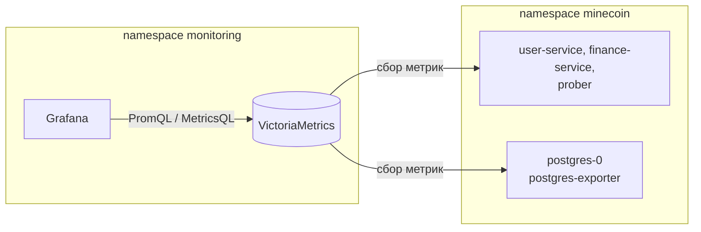

# Отчёт: дашборды Grafana для MineCoin

Работа продолжает [отчёт по алертам](../alerts/Отчёт.md): метрики, которые VictoriaMetrics собирает с сервисов,
пробера и экспортёра PostgreSQL, теперь можно смотреть на дашбордах Grafana.

В namespace `monitoring` добавлена Grafana (чарт `grafana-community/grafana`). Она ходит за данными в ту же
VictoriaMetrics, что и vmalert.



Есть два дашборда:

- **"MineCoin: состояние приложения"** - собран под метрики проекта: общее состояние, SLA пробера, бизнес-метрики
  и рантайм. Файл [`minecoin-dashboard.json`](minecoin-dashboard.json).
- **"PostgreSQL Exporter"** - готовый дашборд [12485](https://grafana.com/grafana/dashboards/12485) с grafana.com,
  импортирован через интерфейс.


## 1. Источник данных

Один источник - **VictoriaMetrics**. Тип `prometheus`: VictoriaMetrics принимает запросы Prometheus API, поэтому
отдельный плагин не нужен. Источник задан в [`grafana-values.yaml`](grafana-values.yaml) и создаётся при старте
Grafana:

```yaml
- name: VictoriaMetrics
  uid: victoriametrics
  type: prometheus
  url: http://vm-single-victoria-metrics-single-server.monitoring.svc:8428
  isDefault: true
  jsonData:
    timeInterval: 15s
```


## 2. Дашборд MineCoin

Дашборд лежит в папке **MineCoin**. Grafana загружает его из ConfigMap `grafana-dashboard-minecoin`, поэтому после
переустановки он появляется сам. Обновление - каждые 30 секунд.

Переменные вверху:

- **application** - сервис (`user-service`, `finance-service`), по умолчанию все;
- **pod** - под выбранного сервиса, по умолчанию все.

Дашборд состоит из четырёх рядов: сверху то, что нужно увидеть за 5 секунд ("всё ли хорошо?"), ниже - детали, по
которым ищут причину.

Соотношение панелей с методиками:

| Методика       | Что показывает                         | Панели                                                         |
|----------------|----------------------------------------|----------------------------------------------------------------|
| RED            | Rate, Errors, Duration запросов        | RPS, доля 5xx/4xx, задержка p50/p95/p99                        |
| USE            | Utilization, Saturation, Errors ресурсов | CPU, память, куча JVM, пул соединений, потоки Tomcat, ошибки в логах |
| Golden Signals | Latency, Traffic, Errors, Saturation   | все панели верхнего ряда и ряд рантайма                        |


### Ряд 1. Обзор: статусы, трафик, ошибки, задержка

| Панель                         | Метрика                                          | Зачем                                            |
|--------------------------------|--------------------------------------------------|--------------------------------------------------|
| Поды в работе                  | `up`, `pg_up`                                    | сколько подов каждого сервиса отвечают; у `user-service` и `finance-service` по 2 реплики: 2 - зелёный, 1 - жёлтый, 0 - красный |
| RPS API                        | `http_server_requests_seconds_count`             | общий трафик                                     |
| Доля 5xx                       | то же, `status=~"5.."`                           | пороги 0,5 % и 5 %: бюджет SLI-1 и порог алерта `HighHttp5xxRate` |
| Задержка p95                   | `http_server_requests_seconds_bucket`            | пороги 300 мс и 1 с                              |
| Успешные прогоны пробера, 5 мин | `minecoin_prober_runs_total`                    | работает ли сценарий пользователя целиком        |
| RPS по сервисам                | `http_server_requests_seconds_count`             | какой сервис принимает трафик                    |
| Доля ошибок по сервисам        | то же, 5xx и 4xx                                 | 5xx - ошибки сервиса, 4xx - ошибки клиента (неверный пароль, нехватка средств) |
| Задержка по сервисам           | `histogram_quantile` по бакетам                  | p50, p95 и p99 для каждого сервиса               |
| Запросы по эндпоинтам          | `..._count` по `method` и `uri`                  | какой эндпоинт даёт нагрузку                     |
| Ответы по статусам             | `..._count` по `status`                          | распределение кодов ответа                       |

Доля ошибок считается так, чтобы при отсутствии ошибок было 0, а не пустой график:

```
(sum(rate(..._count{status=~"5.."}[$__rate_interval])) or sum(rate(..._count[$__rate_interval])) * 0)
  / sum(rate(..._count[$__rate_interval]))
```

Ряд `status="500"` появляется только после первой ошибки. До этого `or ... * 0` подставляет ноль.


### Ряды 2-3. SLA пробера и Бизнес-метрики

Собственные метрики сервисов `minecoin_*`, в событиях в минуту:

| Панель                 | Метрика                                    | Зачем                                                |
|------------------------|--------------------------------------------|------------------------------------------------------|
| Входы по результату    | `minecoin_auth_logins_total{result}`       | успешные и неудачные входы; всплеск неудачных - подбор пароля (`LoginBruteForce`) |
| Переводы по результату | `minecoin_wallet_transfers_total{result}`  | переводы и причины отказа                            |
| Операции кошелька      | `minecoin_wallet_operations_total{type,result}` | пополнения и переводы                           |

HTTP-метрики показывают, что сервис отвечает, а эти - что пользователи действительно входят и переводят деньги.


### Ряд 4. Рантайм: загрузка и насыщение

| Панель                       | Метрика                                                | Зачем                                    |
|------------------------------|--------------------------------------------------------|------------------------------------------|
| CPU процесса                 | `process_cpu_usage`                                    | загрузка CPU JVM                         |
| Память пода от лимита        | `container_memory_working_set_bytes / container_spec_memory_limit_bytes` | близость к OOMKill (cAdvisor) |
| Куча JVM                     | `jvm_memory_used_bytes / jvm_memory_max_bytes`, `area="heap"` | линия на 85 % - порог `JvmHeapHigh` |
| Время в сборке мусора        | `rate(jvm_gc_pause_seconds_sum)`                       | доля времени, которую JVM стоит на GC    |
| Пул соединений к базе        | `hikaricp_connections_{active,idle,pending,max}`       | насыщение пула: `pending > 0` - запросы ждут соединения |
| Занятые потоки Tomcat        | `tomcat_threads_busy_threads`                          | насыщение потоков обработки запросов     |
| Ошибки и предупреждения в логах | `logback_events_total{level=~"error\|warn"}`        | ошибки, которые не видны в HTTP-статусах |
| Потоки JVM                   | `jvm_threads_live_threads`                             | утечка потоков                           |


## 3. SLA пробера

SLA определён в [отчёте по SLO](../slo/Отчёт_slo.md): минута доступна, если за неё пробер прошёл сценарий хотя
бы раз и ни разу не упал; доступно должно быть не менее **99 %** минут за 30 дней.

Индикатор минуты (1 - хорошая, 0 - плохая):

```
(
  ((sum(increase(minecoin_prober_runs_total{result="failure"}[1m])) or vector(0)) == bool 0)
* ((sum(increase(minecoin_prober_runs_total{result="success"}[1m])) or vector(0)) > bool 0)
) and on() (max(minecoin_prober_runs_total) >= 0)
```

Последняя строка убирает минуты, когда пробер не собирался совсем (например, кластер был выключен): их нельзя
считать ни хорошими, ни плохими.

Панели ряда:

| Панель                        | Запрос                                         | Зачем                                    |
|-------------------------------|------------------------------------------------|------------------------------------------|
| SLA за 30 дней                | `avg_over_time((индикатор)[30d:1m])`           | выполнение обещания; красный < 99 %, жёлтый < 99,5 % (внутренний SLO), зелёный |
| SLA за 24 часа                | то же за `[24h:1m]`                            | текущее состояние, без старых сбоев      |
| Плохих минут за 30 дней       | `count_over_time(((индикатор) == 0)[30d:1m])`  | сколько бюджета потрачено                |
| Осталось допустимого простоя  | `432 - плохие минуты`                          | 1 % от 30 дней = 432 минуты              |
| SLA за скользящий час         | `avg_over_time((индикатор)[1h:1m])` и линия 0,99 | когда и насколько проседала доступность |
| Прогоны пробера в минуту      | `increase(minecoin_prober_runs_total[1m])` по `result` | успешные и неудачные прогоны      |
| Неудачные шаги пробера        | `minecoin_prober_checks_total{result="failure"}` по `step` | на каком шаге ломается сценарий |
| Время шагов пробера           | `minecoin_prober_check_duration_seconds`       | какой шаг замедлился                     |


## 4. Дашборд PostgreSQL Exporter

Метрики PostgreSQL отдаёт `postgres-exporter` (`prometheuscommunity/postgres-exporter:v0.20.1`) - второй контейнер в
поде `postgres-0`, порт 9187. VictoriaMetrics собирает его так же, как остальные поды, по аннотациям.

Импорт:

1. Dashboards → New → Import, ID `12485`, Load.
2. В качестве источника данных выбран **VictoriaMetrics**.
3. Переменная **Instance** в дашборде ищет экспортёр по `job="postgres-exporter"`. У нас все поды собираются одной
   задачей `kubernetes-pods`, поэтому запрос переменной заменён на `label_values(pg_up, instance)`.
4. Instance `10.244.0.3:9187`, Database `finance_db`, Interval `1m`.

Что показывает дашборд: число подключений и их состояния, долю попаданий в shared buffers, долю коммитов,
транзакции и операции со строками, блокировки, deadlock-и, временные файлы. Пробер каждые 10 секунд делает
пополнение и перевод, поэтому графики транзакций и строк по `finance_db` живые.

Часть панелей пустая - дашборд сделан в 2020 году под старый экспортёр:

| Панели                               | Почему пусто                                                     |
|--------------------------------------|------------------------------------------------------------------|
| Total database size, Database size   | метрика переименована: `pg_database_size` → `pg_database_size_bytes` |
| PostgreSQL Uptime                    | `pg_postmaster_start_time_seconds` в v0.20 по умолчанию не собирается |
| Max Replication Lag, Replication lag | репликации нет, одна база                                        |
| Query rate, Average query runtime    | нужно расширение `pg_stat_statements`, оно не установлено        |


## 5. Развёртывание

Команды выполняются из корня репозитория; приложение и VictoriaMetrics уже развернуты по
[`../Отчёт_k8s.md`](../Отчёт_k8s.md).

```powershell
powershell -ExecutionPolicy Bypass -File k8s/grafana/deploy_grafana.ps1
```

Скрипт [`deploy_grafana.ps1`](deploy_grafana.ps1):

1. добавляет репозиторий `grafana-community`;
2. ставит или обновляет VictoriaMetrics;
3. создаёт ConfigMap `grafana-dashboard-minecoin` из `minecoin-dashboard.json`;
4. ставит Grafana чартом `grafana-community/grafana` 14.4.1 с настройками [`grafana-values.yaml`](grafana-values.yaml)
   и ждёт готовности пода.

Настройки Grafana:

- источник данных VictoriaMetrics и папка дашбордов MineCoin создаются при старте;
- диск 1Gi (`persistence`): импортированный руками дашборд PostgreSQL сохраняется при перезапуске пода;
- ресурсы: requests 50m CPU и 128Mi RAM, limit 384Mi RAM;
- отключены проверка обновлений и отправка статистики.

Пароль `admin` чарт генерирует сам и кладёт в Secret `grafana`:

```powershell
[Text.Encoding]::UTF8.GetString([Convert]::FromBase64String((kubectl get secret grafana -n monitoring -o jsonpath='{.data.admin-password}')))
```

Веб-интерфейс:

```powershell
kubectl port-forward svc/grafana 3000:80 -n monitoring
```

`http://localhost:3000`, логин `admin`.
