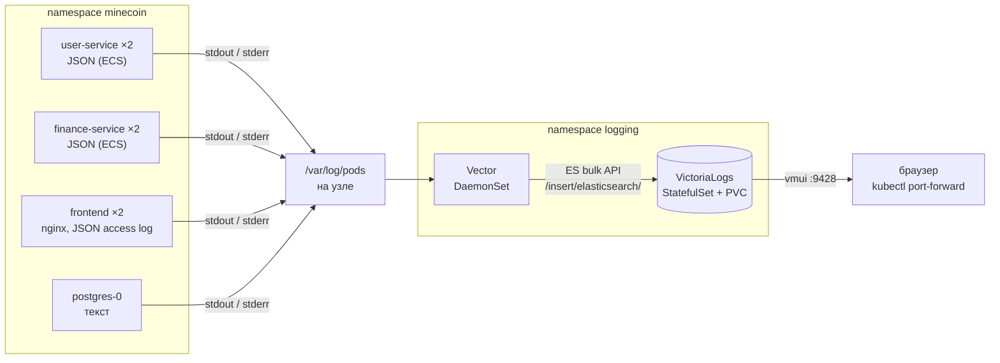

# Отчёт: доставка логов MineCoin в VictoriaLogs

В тот же кластер minikube, где работает MineCoin (см. [`../Отчёт_k8s.md`](../Отчёт_k8s.md)), развёрнуты:
- **VictoriaLogs** (single-node) — хранилище логов с языком запросов LogsQL и веб-интерфейсом vmui;
- **Vector** — агент, который на каждом узле читает логи контейнеров и отправляет их в VictoriaLogs.



Все файлы — в этой папке:

| Файл | Что в нём |
|---|---|
| [`00_namespace.yml`](00_namespace.yml) | Namespace `logging` |
| [`10_victorialogs.yml`](10_victorialogs.yml) | Service + StatefulSet VictoriaLogs с постоянным диском |
| [`20_vector_rbac.yml`](20_vector_rbac.yml) | ServiceAccount, ClusterRole и ClusterRoleBinding для Vector |
| [`21_vector_config.yml`](21_vector_config.yml) | ConfigMap с конфигурацией Vector (источник, преобразование, отправка) |
| [`22_vector_daemonset.yml`](22_vector_daemonset.yml) | DaemonSet Vector |

## 1. Логи приложения в JSON

### Java-сервисы: уже JSON

`user-service` и `finance-service` пишут логи в stdout в формате **ECS** (Elastic Common Schema) — это встроенный в Spring Boot структурированный формат. Он включается переменной окружения `LOGGING_STRUCTURED_FORMAT_CONSOLE=ecs` из ConfigMap ([`20_user_service_config.yml`](../20_user_service_config.yml), [`30_finance_service_config.yml`](../30_finance_service_config.yml)), код для этого не менялся. Пример строки:
```json
{"@timestamp":"2026-10-15T10:00:00.123Z","log":{"level":"WARN","logger":"c.m.f.i.web.GlobalExceptionHandler"},"process":{"pid":1,"thread":{"name":"http-nio-8082-exec-3"}},"service":{"name":"finance-service","version":"0.0.1-SNAPSHOT"},"message":"User service call failed","ecs":{"version":"8.11"}}
```

### nginx (frontend): переведён из текста в JSON

Раньше access-лог nginx был текстовым. Теперь он пишется в JSON с **теми же именами полей**, что у ECS, чтобы запросы LogsQL одинаково работали по всем сервисам ([`Frontend/nginx/default.conf.template`](../../Frontend/nginx/default.conf.template)):
```json
{"@timestamp":"2026-10-15T10:00:00+00:00","log.level":"ERROR","log.logger":"nginx.access","service.name":"frontend","message":"POST /api/wallets/me/transfer 503","http.request.method":"POST","url.path":"/api/wallets/me/transfer","http.response.status_code":503,"http.request.duration_seconds":0.015,"upstream.address":"10.96.12.7:8082","request_id":"c0ffee…","client.address":"10.244.0.1"}
```
- `log_format … escape=json` — nginx сам экранирует значения переменных, поэтому строка всегда валидный JSON. Код ответа и время ответа записаны **числами**, а не строками: по ним работают фильтры `>=` и `quantile`;
- **уровень по коду ответа** (`map $status $log_level`): 5xx → `ERROR`, 4xx → `WARN`, остальное → `INFO`. У access-лога нет собственного уровня, а так ошибки шлюза находятся тем же фильтром `log.level`, что и ошибки сервисов;
- **запросы проверок здоровья не логируются** (`map $http_user_agent $loggable`, `access_log … if=$loggable`): пробы Kubernetes (`User-Agent: kube-probe/…`) и healthcheck Docker Compose (`wget`) стучатся в `/` каждые 5–10 секунд с каждой реплики и забили бы журнал бесполезными строками;
- `request_id` — тот же идентификатор, что nginx возвращает клиенту в заголовке `X-Request-Id`.

### Поля, на которые опираются запросы

| Поле | Откуда | Смысл |
|---|---|---|
| `_time` | Vector (время чтения строки) | время записи |
| `_msg` | поле `message` | текст сообщения |
| `log.level` | ECS / nginx / вычисляется Vector | `INFO`, `WARN`, `ERROR` |
| `service.name` | ECS (`spring.application.name`) / nginx / имя контейнера | `user-service`, `finance-service`, `frontend`, `postgres` |
| `log.logger` | ECS / nginx | класс-источник сообщения |
| `http.response.status_code`, `http.request.duration_seconds`, `url.path`, `http.request.method` | nginx | HTTP-запросы через шлюз |
| `kubernetes.pod_name`, `kubernetes.container_name`, `kubernetes.pod_namespace`, `kubernetes.pod_node_name` | Vector | откуда пришла строка: под, контейнер, узел |

## 2. Развёртывание VictoriaLogs

**Способ — собственные манифесты** (StatefulSet + Service + PVC), а не Helm-чарт `victoria-logs-single`.
- все манифесты проекта написаны вручную в одном стиле и применяются через `kubectl apply`, без дополнительных инструментов вроде Helm;
- для single-node VictoriaLogs достаточно трёх объектов, и назначение каждого понятно и описано ниже; чарт создал бы больше объектов, которые пришлось бы отдельно разбирать.

| Объект | Зачем                                                                                                                                                  |
|---|--------------------------------------------------------------------------------------------------------------------------------------------------------|
| Namespace `logging` | инфраструктура логирования отделена от приложения: её можно удалить или обновить, не трогая `minecoin`                                                 |
| StatefulSet `victorialogs` (1 реплика) | VictoriaLogs хранит данные, как и PostgreSQL, поэтому ему нужны постоянное имя пода и свой диск                                                        |
| PVC `data-victorialogs-0` (2 ГиБ, `volumeClaimTemplates`) | логи переживают пересоздание пода                                                                                                                      |
| Service `victorialogs` (headless, порт 9428) | постоянный DNS-адрес `victorialogs.logging.svc.cluster.local`, по которому Vector отправляет логи; через него же `kubectl port-forward` открывает vmui |

Параметры запуска:
- `-storageDataPath=/victoria-logs-data` — каталог данных на постоянном диске;
- `-retentionPeriod=7d` — логи старше 7 дней удаляются автоматически, чтобы не переполнить диск;
- `-httpListenAddr=:9428` — один порт и для приёма логов, и для запросов, и для vmui.

Пробы readiness и liveness — `GET /health`. Образ закреплён на конкретной версии `victoriametrics/victoria-logs:v1.53.0`.

## 3. Доставка логов: Vector как DaemonSet

Логи собирает **Vector**, запущенный как **DaemonSet** — по одному агенту на каждый узел кластера ([`22_vector_daemonset.yml`](22_vector_daemonset.yml), конфигурация — [`21_vector_config.yml`](21_vector_config.yml)). Агент читает логи всех контейнеров приложения из `/var/log/pods` на узле, разбирает JSON, приводит поля разных сервисов к одинаковым именам (`log.level`, `service.name`) и отправляет записи в VictoriaLogs через её Elasticsearch-совместимый API (`/insert/elasticsearch/`).

Почему такой способ:
- **приложение не меняется**: сервисы просто пишут логи в stdout (фактор XI 12-factor), а сбор и доставка — забота окружения. При прямой отправке из приложения пришлось бы менять код, а nginx и PostgreSQL так не умеют;
- **один агент на узел** вместо агента-сайдкара в каждом поде: меньше потребление ресурсов, и не нужно менять манифесты сервисов;
- **новые поды подхватываются автоматически** при масштабировании и обновлении, а к каждой записи добавляются метаданные Kubernetes (под, контейнер, узел);
- **Vector** выбран за язык преобразований VRL, на котором разбор JSON и нормализация полей занимают несколько строк, и за документированную интеграцию с VictoriaLogs.

## 4. Развёртывание

Приложение уже развёрнуто по [`../Отчёт_k8s.md`](../Отчёт_k8s.md). Образ `frontend` нужно пересобрать, потому что изменился конфиг nginx (сборка и загрузка — как в разделе 1 основного отчёта), затем перезапустить его поды:
```powershell
kubectl rollout restart deployment/frontend -n minecoin
```

Развернуть логирование (файлы применяются по порядку имён):
```powershell
kubectl apply -f k8s/logging/
```
```powershell
kubectl rollout status statefulset/victorialogs -n logging --timeout=180s
```
```powershell
kubectl rollout status daemonset/vector -n logging --timeout=180s
```
```powershell
kubectl get all,pvc -n logging
```
Vector не должен писать ошибок отправки:
```powershell
kubectl logs daemonset/vector -n logging
```

Открыть vmui (в отдельном окне):
```powershell
kubectl port-forward svc/victorialogs 9428:9428 -n logging
```
Зайти на http://localhost:9428/select/vmui/


## 5. Запросы LogsQL в vmui

В vmui запрос вводится в поле Query. Временной диапазон задаётся либо в самом запросе (`_time:…`), либо переключателем времени в интерфейсе; во всех запросах ниже он указан в самом запросе.

### (а) Сырые записи за последние 5 минут

```
_time:5m
```

Вывожу все записи, которые пришли в VictoriaLogs за последние 5 минут. Запрос показал 17 записей — это access-лог nginx (`frontend`) после того, как я открыл приложение и вошёл: загрузка страницы и статики (`index.html`, `js`, `css`) и запросы к API после входа (`POST /api/auth/login`, `GET /api/users/me`, `GET /api/wallets/…`). Все со статусом 200, поэтому уровень `INFO`.


### (б) Фильтр по полю: только предупреждения

```
_time:5m log.level:=WARN
```

Фильтрую записи за 5 минут по полю `log.level`, оставляю только уровень `WARN`, чтобы отличить от `INFO`. Запрос показал 1 запись: `POST /api/wallets/me/transfer 404` — перед проверкой я попытался перевести деньги несуществующему пользователю, `finance-service` ответил 404 `RECIPIENT_NOT_FOUND`, и nginx записал этот ответ как `WARN`.


### (в) `stats` с группировкой: число записей по сервисам и уровням

```
_time:5m | stats by (service.name, log.level) count() as logs
```

Группирую записи за 5 минут по паре «сервис — уровень» и считаю количество записей в каждой группе. Запрос показал три группы: `frontend / INFO` — 32 записи, `frontend / WARN` — 1 запись, `postgres / INFO` — 2 записи (служебные сообщения PostgreSQL, они текстовые, и уровень для них определил Vector). Java-сервисов в результате нет, потому что за эти 5 минут они ничего не писали: обычные запросы логирует nginx, а `user-service` и `finance-service` пишут в лог при запуске, предупреждениях и ошибках.


### (г) Агрегирующие запросы: top, quantile, count_uniq

```
_time:1h service.name:=frontend http.request.method:* | top 5 by (http.request.method)
```

Вывожу топ-5 самых частых HTTP-методов в запросах через шлюз за последний час через `top`. Фильтр `http.request.method:*` убирает служебные nginx логи, у которых тоже `service.name` это `frontend`, чтобы не выделялись в отдельную категорию. Запрос показал два метода: `GET` — 47 запросов (статика, профиль, баланс, история), `POST` — 4 запроса (вход, пополнение, перевод). `PUT` и `DELETE` за этот час не вызывались, поэтому строк в топе две, а не пять.


```
_time:1h service.name:=frontend | stats by (http.request.method) quantile(0.95, http.request.duration_seconds) p95
```

Считаю 95-й перцентиль времени ответа через `quantile` отдельно для каждого HTTP-метода за последний час — время, в которое уложились 95% запросов. Запрос показал: `POST` — 0,595 с, `GET` — 0,296 с. `POST` ожидаемо медленнее: это вход (проверка пароля через BCrypt специально сделана медленной) и денежные операции с записью в базу и блокировкой кошелька, а `GET` в основном отдаёт статику и читает данные. Размер ответа в байтах, как в упражнении с семинара, nginx в наш лог не пишет, поэтому вместо него взято время ответа.


```
_time:1h service.name:=frontend http.response.status_code:>=400 | stats count_uniq(client.address) clients
```

Агрегирую ошибочные ответы шлюза через `count_uniq` (код ответа >= 400) за последний час и считаю, сколько среди них уникальных клиентов (`count_uniq` по `client.address`). За час таких записей 2 (на графике — около 19:05 и около 19:25): неудачный перевод несуществующему получателю из запроса (б) и попытка войти как несуществующий пользователь. Но запрос показал 1 клиента, потому что у обеих записей одинаковый `client.address`: в minikube запросы снаружи проходят через NAT узла, и nginx видит один и тот же адрес для всех клиентов.


## 6. Ресурсы

| Компонент | CPU requests | RAM requests | RAM limits |
|---|---|---|---|
| VictoriaLogs | 100m | 128Mi | 512Mi |
| Vector (на каждый узел) | 50m | 64Mi | 256Mi |

Вместе с приложением это укладывается в рекомендуемые 4 CPU / 6 ГиБ для minikube (расчёт — в разделе 0 [`../Отчёт_k8s.md`](../Отчёт_k8s.md)).

Удалить стек логирования вместе с сохранёнными логами (при удалении namespace `logging` удаляется и его PVC; ClusterRole и ClusterRoleBinding удаляются той же командой, так как описаны в тех же файлах):
```powershell
kubectl delete -f k8s/logging/
```
