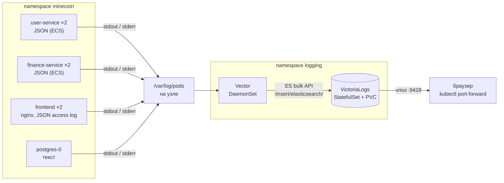
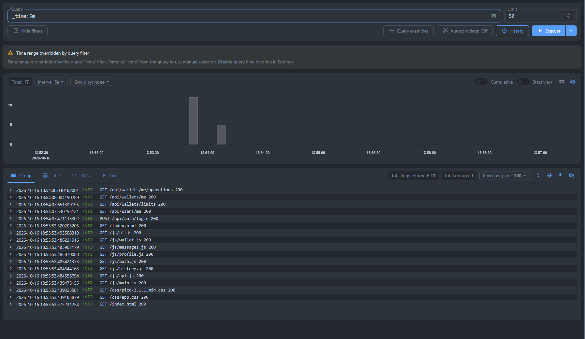
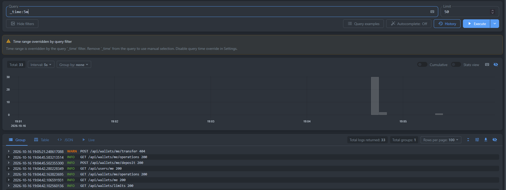
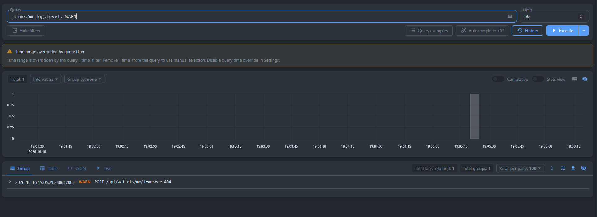
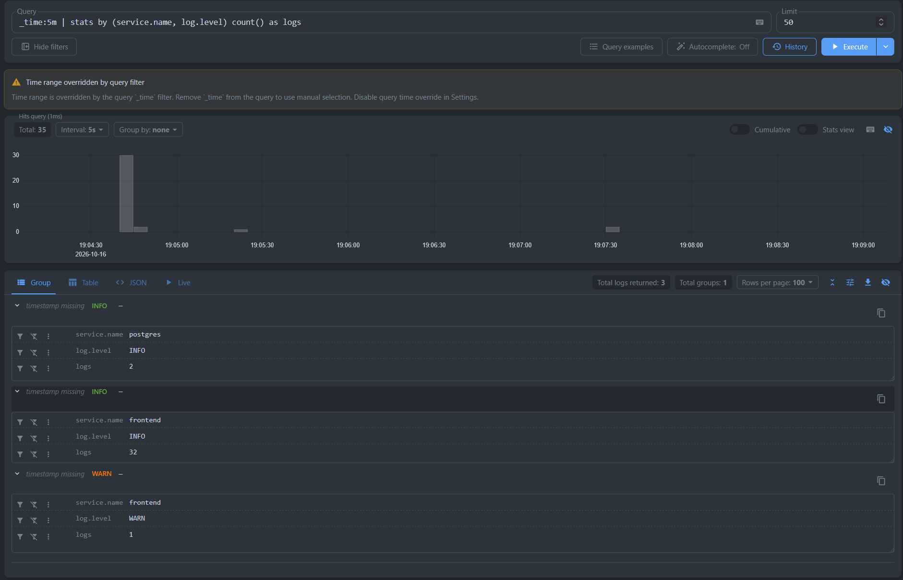
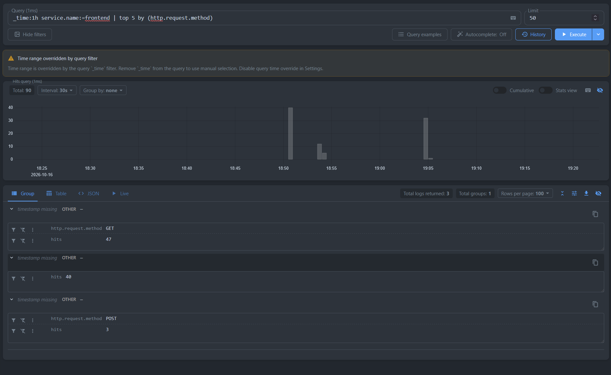
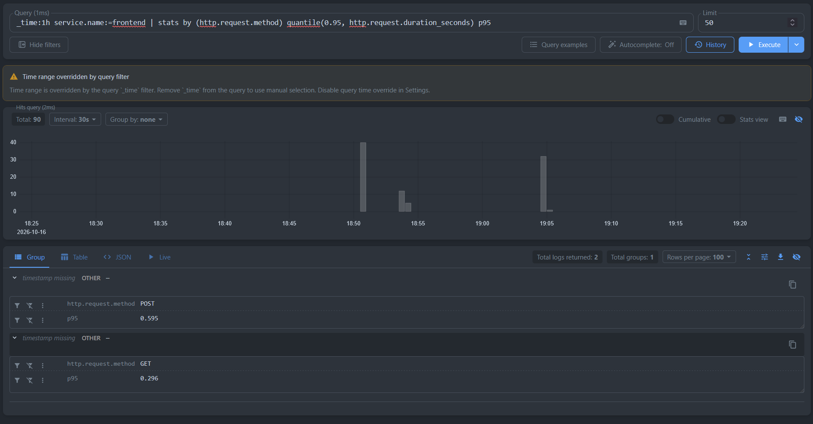
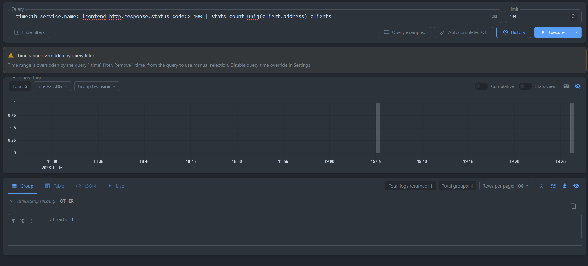

# Отчёт: доставка логов MineCoin в VictoriaLogs

В тот же кластер minikube, где работает MineCoin (см. [`../Отчёт.md`](../Отчёт.md)), развёрнуты:
- **VictoriaLogs** (single-node) — хранилище логов с языком запросов LogsQL и веб-интерфейсом vmui;
- **Vector** — агент, который на каждом узле читает логи контейнеров и отправляет их в VictoriaLogs.



Все файлы — в этой папке:

| Файл | Что в нём |
|---|---|
| [`00_namespace.yml`](00_namespace.yml) | Namespace `logging` |
| [`10_victorialogs.yml`](10_victorialogs.yml) | Service + StatefulSet VictoriaLogs с постоянным диском |
| [`20_vector_rbac.yml`](20_vector_rbac.yml) | ServiceAccount, ClusterRole и ClusterRoleBinding для Vector |
| [`21_vector_config.yml`](21_vector_config.yml) | ConfigMap с конфигурацией Vector (источник, преобразование, отправка) |
| [`22_vector_daemonset.yml`](22_vector_daemonset.yml) | DaemonSet Vector |

## 1. Логи приложения в JSON

### Java-сервисы: уже JSON

`user-service` и `finance-service` пишут логи в stdout в формате **ECS** (Elastic Common Schema) — это встроенный в Spring Boot структурированный формат. Он включается переменной окружения `LOGGING_STRUCTURED_FORMAT_CONSOLE=ecs` из ConfigMap ([`20_user_service_config.yml`](../20_user_service_config.yml), [`30_finance_service_config.yml`](../30_finance_service_config.yml)), код для этого не менялся. Пример строки:
```json
{"@timestamp":"2026-10-15T10:00:00.123Z","log":{"level":"WARN","logger":"c.m.f.i.web.GlobalExceptionHandler"},"process":{"pid":1,"thread":{"name":"http-nio-8082-exec-3"}},"service":{"name":"finance-service","version":"0.0.1-SNAPSHOT"},"message":"User service call failed","ecs":{"version":"8.11"}}
```

### nginx (frontend): переведён из текста в JSON

Раньше access-лог nginx был текстовым. Теперь он пишется в JSON с **теми же именами полей**, что у ECS, чтобы запросы LogsQL одинаково работали по всем сервисам ([`Frontend/nginx/default.conf.template`](../../Frontend/nginx/default.conf.template)):
```json
{"@timestamp":"2026-10-15T10:00:00+00:00","log.level":"ERROR","log.logger":"nginx.access","service.name":"frontend","message":"POST /api/wallets/me/transfer 503","http.request.method":"POST","url.path":"/api/wallets/me/transfer","http.response.status_code":503,"http.request.duration_seconds":0.015,"upstream.address":"10.96.12.7:8082","request_id":"c0ffee…","client.address":"10.244.0.1"}
```
- `log_format … escape=json` — nginx сам экранирует значения переменных, поэтому строка всегда валидный JSON. Код ответа и время ответа записаны **числами**, а не строками: по ним работают фильтры `>=` и `quantile`;
- **уровень по коду ответа** (`map $status $log_level`): 5xx → `ERROR`, 4xx → `WARN`, остальное → `INFO`. У access-лога нет собственного уровня, а так ошибки шлюза находятся тем же фильтром `log.level`, что и ошибки сервисов;
- **запросы проверок здоровья не логируются** (`map $http_user_agent $loggable`, `access_log … if=$loggable`): пробы Kubernetes (`User-Agent: kube-probe/…`) и healthcheck Docker Compose (`wget`) стучатся в `/` каждые 5–10 секунд с каждой реплики и забили бы журнал бесполезными строками;
- `request_id` — тот же идентификатор, что nginx возвращает клиенту в заголовке `X-Request-Id`.

### Поля, на которые опираются запросы

| Поле | Откуда | Смысл |
|---|---|---|
| `_time` | Vector (время чтения строки) | время записи |
| `_msg` | поле `message` | текст сообщения |
| `log.level` | ECS / nginx / вычисляется Vector | `INFO`, `WARN`, `ERROR` |
| `service.name` | ECS (`spring.application.name`) / nginx / имя контейнера | `user-service`, `finance-service`, `frontend`, `postgres` |
| `log.logger` | ECS / nginx | класс-источник сообщения |
| `http.response.status_code`, `http.request.duration_seconds`, `url.path`, `http.request.method` | nginx | HTTP-запросы через шлюз |
| `kubernetes.pod_name`, `kubernetes.container_name`, `kubernetes.pod_namespace`, `kubernetes.pod_node_name` | Vector | откуда пришла строка: под, контейнер, узел |

## 2. Развёртывание VictoriaLogs

**Способ — собственные манифесты** (StatefulSet + Service + PVC), а не Helm-чарт `victoria-logs-single`.
- были написаны манифесты проекта, применяются через `kubectl apply`, без дополнительных инструментов;
- для single-node VictoriaLogs нужно всего три объекта, что было легче писать.

| Объект | Зачем                                                                                                                                                  |
|---|--------------------------------------------------------------------------------------------------------------------------------------------------------|
| Namespace `logging` | инфраструктура логирования отделена от приложения: её можно удалить или обновить, не трогая `minecoin`                                                 |
| StatefulSet `victorialogs` (1 реплика) | VictoriaLogs хранит данные, как и PostgreSQL, поэтому ему нужны постоянное имя пода и свой диск                                                        |
| PVC `data-victorialogs-0` (2 ГиБ, `volumeClaimTemplates`) | логи переживают пересоздание пода                                                                                                                      |
| Service `victorialogs` (headless, порт 9428) | постоянный DNS-адрес `victorialogs.logging.svc.cluster.local`, по которому Vector отправляет логи; через него же `kubectl port-forward` открывает vmui |

Параметры запуска:
- `-storageDataPath=/victoria-logs-data` — каталог данных на постоянном диске;
- `-retentionPeriod=7d` — логи старше 7 дней удаляются автоматически, чтобы не переполнить диск;
- `-httpListenAddr=:9428` — один порт и для приёма логов, и для запросов, и для vmui.

Пробы readiness и liveness — `GET /health`. Образ закреплён на конкретной версии `victoriametrics/victoria-logs:v1.53.0`.

## 3. Доставка логов: Vector как DaemonSet

### Почему именно так

| Вариант из задания | Почему не выбран |
|---|---|
| сайдкар с агентом в каждом поде | по агенту на каждый под: при 7 подах приложения — 7 агентов, каждый с запасом памяти; пришлось бы менять манифесты всех Deployment |
| прямой push из приложения (Logback-appender в ES/Loki) | приложение начинает зависеть от системы логирования и знать её адрес (нарушение фактора XI: приложение пишет логи в stdout, а маршрутизация — забота окружения); nginx и PostgreSQL так не умеют; нужно менять код |
| OpenTelemetry Collector | тоже рабочий вариант (DaemonSet с `filelog`), но конфигурация сложнее, а метрики и трейсы нам не нужны |
| **DaemonSet с Vector** | **выбран** |

Плюсы DaemonSet:
- **один агент на узел** читает логи **всех** контейнеров узла из `/var/log/pods`, куда Kubernetes и так сохраняет stdout/stderr контейнеров;
- **приложение не меняется**: оно просто пишет в stdout, как требует фактор XI;
- новые поды (масштабирование, обновление) подхватываются автоматически;
- к каждой строке добавляются метаданные Kubernetes: namespace, под, контейнер, узел.

Почему Vector, а не Fluent Bit: оба подходят, но у Vector есть язык преобразований VRL, на котором разбор JSON и нормализация полей записываются в несколько понятных строк. У VictoriaLogs есть документированная интеграция с Vector.

### Что делает каждая часть конфигурации ([`21_vector_config.yml`](21_vector_config.yml))

**Источник `kubernetes_logs`** читает файлы логов подов на своём узле. `extra_field_selector: metadata.namespace=minecoin` — собираются логи **только приложения**: не системных подов и не самого стека логирования (иначе Vector отправлял бы в VictoriaLogs собственные логи о доставке логов).

**Преобразование `normalize` (VRL):**
1. `parse_json(.message)` — если строка лога — JSON-объект (Spring, nginx), его поля поднимаются на верхний уровень события, а исходная строка заменяется полем `message` из JSON;
2. `del(...)` — удаляются шумные метаданные (аннотации и метки namespace и узла, хеш шаблона, идентификаторы контейнеров), которые не нужны для поиска, но занимают место;
3. `flatten(., ".")` — вложенные объекты превращаются в плоские имена через точку: `{"log":{"level":"WARN"}}` от Spring становится `log.level`, так же как у nginx. В результате у всех сервисов одинаковые имена полей;
4. для **текстовых** строк (PostgreSQL, служебные сообщения nginx при старте и его error-лог) `service.name` берётся из имени контейнера, а `log.level` определяется по словам `error`, `fatal`, `warn` и т.п. в тексте (иначе `INFO`). Синонимы приводятся к трём уровням: `FATAL`, `PANIC`, `CRIT` → `ERROR`, `WARNING` → `WARN`.

**Отправка `elasticsearch` → VictoriaLogs.** VictoriaLogs принимает данные по протоколу Elasticsearch bulk API (`/insert/elasticsearch/`). У Vector для него зрелый приёмник с пакетной отправкой, сжатием (`gzip`) и повторами при ошибках. Параметры `query` сообщают VictoriaLogs, как трактовать поля:
- `_msg_field: message` — поле с текстом сообщения (`_msg` в LogsQL);
- `_time_field: timestamp` — поле со временем записи (`_time`);
- `_stream_fields: kubernetes.pod_namespace,kubernetes.pod_name,kubernetes.container_name` — **поток** (stream) логов: строки одного контейнера одного пода хранятся вместе. В потоки входят только поля с небольшим числом значений; `request_id` или `url.path` туда класть нельзя;
- `healthcheck.enabled: false` — Vector не проверяет кластер Elasticsearch при старте (VictoriaLogs не реализует эту служебную проверку).

### DaemonSet и права ([`22_vector_daemonset.yml`](22_vector_daemonset.yml), [`20_vector_rbac.yml`](20_vector_rbac.yml))

- **ClusterRole** с правами `get`, `list` и `watch` на `pods`, `namespaces`, `nodes`: по ним Vector узнаёт, какому поду и контейнеру принадлежит файл лога;
- `VECTOR_SELF_NODE_NAME` из `spec.nodeName` — каждый экземпляр Vector обрабатывает только поды своего узла;
- монтирования с узла (`hostPath`, только чтение):
    - `/var/log` — там `/var/log/pods` с логами контейнеров;
    - `/var/lib` и `/mnt` — файлы в `/var/log/pods` часто являются символическими ссылками на каталоги среды выполнения: при Docker это `/var/lib/docker/containers/…`, а в виртуальной машине minikube эти каталоги лежат на постоянном диске, смонтированном в `/mnt`. Без этих монтирований ссылки внутри контейнера Vector вели бы в никуда;
- `/var/lib/vector` с узла → `/vector-data-dir` (запись) — Vector запоминает, до какого места прочитан каждый файл, и после перезапуска не отправляет логи повторно;
- `tolerations` для `control-plane` — агент запускается и на управляющем узле (актуально для кластеров из нескольких узлов, например kind);
- пробы — `GET /health` встроенного API Vector на порту 8686;
- ресурсы — `requests` 50m CPU / 64Mi, `limits` 256Mi.

## 4. Развёртывание

Приложение уже развёрнуто по [`../Отчёт.md`](../Отчёт.md). Образ `frontend` нужно пересобрать, потому что изменился конфиг nginx (сборка и загрузка — как в разделе 1 основного отчёта), затем перезапустить его поды:
```powershell
kubectl rollout restart deployment/frontend -n minecoin
```

Развернуть логирование (файлы применяются по порядку имён):
```powershell
kubectl apply -f k8s/logging/
```
```powershell
kubectl rollout status statefulset/victorialogs -n logging --timeout=180s
```
```powershell
kubectl rollout status daemonset/vector -n logging --timeout=180s
```
```powershell
kubectl get all,pvc -n logging
```
Vector не должен писать ошибок отправки:
```powershell
kubectl logs daemonset/vector -n logging
```

Открыть vmui (в отдельном окне):
```powershell
kubectl port-forward svc/victorialogs 9428:9428 -n logging
```
Зайти на http://localhost:9428/select/vmui/


## 5. Запросы LogsQL в vmui

В vmui запрос вводится в поле Query. Временной диапазон задаётся либо в самом запросе (`_time:…`).

### (а) Сырые записи за последние 5 минут

```
_time:5m
```




### (б) Фильтр по полю: только предупреждения

```
_time:5m log.level:=WARN
```




### (в) `stats` с группировкой: число записей по сервисам и уровням

```
_time:5m | stats by (service.name, log.level) count() as logs
```



### (г) Агрегирующий запрос: 95-й перцентиль времени ответа по адресам API

```
_time:1h service.name:=frontend | top 5 by (http.request.method)
```



```
_time:1h service.name:=frontend | stats by (http.request.method) quantile(0.95, http.request.duration_seconds) p95
```



```
_time:5m service.name:=frontend http.response.status_code:>=400 | stats count_uniq(client.address) clients
```



## 6. Ресурсы

| Компонент | CPU requests | RAM requests | RAM limits |
|---|---|---|---|
| VictoriaLogs | 100m | 128Mi | 512Mi |
| Vector (на каждый узел) | 50m | 64Mi | 256Mi |

Вместе с приложением это укладывается в рекомендуемые 4 CPU / 6 ГиБ для minikube (расчёт — в разделе 0 [`../Отчёт.md`](../Отчёт.md)).

Удалить стек логирования вместе с сохранёнными логами (при удалении namespace `logging` удаляется и его PVC; ClusterRole и ClusterRoleBinding удаляются той же командой, так как описаны в тех же файлах):
```powershell
kubectl delete -f k8s/logging/
```
