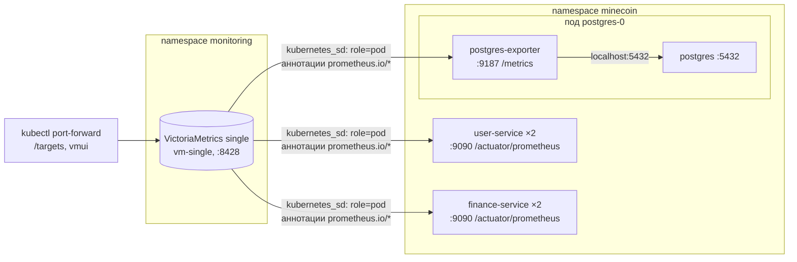

# Отчёт: метрики MineCoin в VictoriaMetrics

В тот же кластер minikube, где работает MineCoin (см. [`../Отчёт_k8s.md`](../Отчёт_k8s.md)), добавлены:

- **VictoriaMetrics single** — база временных рядов, установлена Helm-чартом; она же сама собирает метрики (scrape);
- **экспорт метрик рантайма** из `user-service` и `finance-service` — Spring Boot Actuator + Micrometer;
- **postgres-exporter** — метрики PostgreSQL;
- **бизнес-метрики** — пять собственных метрик предметной области.



## 1. VictoriaMetrics через Helm

Установка — по [руководству VictoriaMetrics](https://docs.victoriametrics.com/guides/k8s-monitoring-via-vm-single/),
чарт `vm/victoria-metrics-single` (версия чарта 0.49.0, VictoriaMetrics v1.154.0):

```powershell
helm repo add vm https://victoriametrics.github.io/helm-charts/
```

```powershell
helm repo update
```

```powershell
helm install vm-single vm/victoria-metrics-single -n monitoring --create-namespace -f k8s/monitoring/vmsingle-values.yaml
```

## 2. Service discovery по аннотациям

Поды, с которых нужно собирать метрики, находятся автоматически: за это отвечает задание `kubernetes-pods` в
[`vmsingle-values.yaml`](vmsingle-values.yaml). VictoriaMetrics опрашивает только поды с аннотацией
`prometheus.io/scrape: "true"`, а порт и путь берет из аннотаций `prometheus.io/port` и `prometheus.io/path`.

Аннотации добавлены в шаблоны подов:
- `user-service` и `finance-service` ([`22_user_service.yml`](../22_user_service.yml),
  [`32_finance_service.yml`](../32_finance_service.yml)) — порт `9090`, путь `/actuator/prometheus`;
- `postgres` ([`10_postgres.yml`](../10_postgres.yml)) — порт `9187`, путь `/metrics` (контейнер `postgres-exporter`).

К собранным метрикам добавляются метки `namespace`, `pod`, `container` и `app`.

Новые реплики подхватываются сами: после `kubectl scale` VictoriaMetrics начнет опрашивать новые поды без изменения
конфигурации. Порты метрик не добавлены в Service, поэтому снаружи кластера они недоступны.

## 3. Метрики рантайма: Actuator + Micrometer

Spring Boot Actuator уже был подключен для проверок здоровья. Micrometer — встроенная в Spring Boot библиотека метрик;
Код пишет метрики через общий API, а зависимость `micrometer-registry-prometheus` добавляет эндпоинт
`/actuator/prometheus`, который отдает их в текстовом формате Prometheus. VictoriaMetrics этот формат может
обрабатывать.

Что экспортируется:

| Группа              | Метрики                                                                                                   |
|---------------------|-----------------------------------------------------------------------------------------------------------|
| JVM                 | `jvm_memory_used_bytes`, `jvm_gc_pause_seconds`, `jvm_threads_live_threads`, `jvm_classes_loaded_classes` |
| процесс и CPU       | `process_cpu_usage`, `system_cpu_usage`, `process_uptime_seconds`                                         |
| HTTP                | `http_server_requests_seconds_count/_sum/_bucket` с метками `method`, `uri`, `status`, `outcome`          |
| пул соединений с БД | `hikaricp_connections_active`, `hikaricp_connections_pending`                                             |
| Tomcat              | `tomcat_sessions_active_current_sessions`, `tomcat_threads_busy_threads`                                  |
| логирование         | `logback_events_total` по уровням                                                                         |

Job миграций и создания администратора запускают то же приложение без веб-сервера, поэтому порт управления у них не
поднимается и аннотаций нет.

## 4. Метрики PostgreSQL: postgres-exporter

[postgres-exporter](https://github.com/prometheus-community/postgres_exporter) — стандартный экспортер Prometheus для
PostgreSQL: подключается к базе, выполняет запросы к системным представлениям (`pg_stat_database`, `pg_stat_activity`,
`pg_locks` и т.д.) и отдает результат на `:9187/metrics`.

Он запущен **вторым контейнером в поде `postgres-0`** (sidecar):

Основные метрики: `pg_up` (экспортер смог подключиться к базе), `pg_stat_database_xact_commit` / `_xact_rollback` (
транзакции по базам `users_db`, `finance_db`), `pg_stat_database_blks_hit` / `_blks_read` (попадания в кэш),
`pg_stat_database_deadlocks`, `pg_stat_activity_count` (соединения), `pg_database_size_bytes`, `pg_locks_count`.

## 5. Бизнес-метрики

Метрики создаются прямо в слое `service`: `MeterRegistry` из Micrometer внедряется в конструкторы `UserService` и
`WalletService` (поле `metrics`).

Имена в коде пишутся через точку, при экспорте Micrometer превращает их в имена Prometheus: `minecoin.auth.logins` →
`minecoin_auth_logins_total`.

| Метрика                                                       | Тип                  | Метки                                                                                                                                  | Сервис          | Что показывает                                                                             |
|---------------------------------------------------------------|----------------------|----------------------------------------------------------------------------------------------------------------------------------------|-----------------|--------------------------------------------------------------------------------------------|
| `minecoin_auth_registrations_total`                           | Counter              | —                                                                                                                                      | user-service    | приток новых пользователей                                                                 |
| `minecoin_auth_logins_total`                                  | Counter              | `result`: `success`, `invalid_credentials`, `user_blocked`                                                                             | user-service    | попытки входа; всплеск неудачных — признак подбора пароля                                  |
| `minecoin_wallet_operations_total`                            | Counter              | `type`: `deposit`, `withdraw`; `result`: `success`, `insufficient_funds`, `amount_limit_exceeded`                                      | finance-service | пополнения и снятия и причины отказов                                                      |
| `minecoin_wallet_transfers_total`                             | Counter              | `result`: `success`, `insufficient_funds`, `amount_limit_exceeded`, `recipient_not_found`, `self_transfer`, `user_service_unavailable` | finance-service | переводы между пользователями и причины отказов, в том числе недоступность `user-service`  |
| `minecoin_wallet_operation_amount` (`_count`, `_sum`, `_max`) | Distribution summary | `type`: `deposit`, `withdraw`, `transfer`                                                                                              | finance-service | объем денег в MNC по успешным операциям: сколько пополнили, сняли, перевели, средняя сумма |

Для счетчиков добавлены интеграционные тесты: `UserApiIT.registrationsAndLoginOutcomesAreCounted`,
`WalletServiceIT.operationsAndTransfersAreCountedByResult`.

## 6. Ресурсы

| Компонент              | CPU requests | RAM requests | RAM limits |
|------------------------|--------------|--------------|------------|
| VictoriaMetrics single | 100m         | 256Mi        | 512Mi      |
| postgres-exporter      | 20m          | 32Mi         | 64Mi       |

Вместе с приложением, логированием и системными подами в `requests` получается ~2,5 CPU и ~2,9 ГиБ — кластер
из [раздела 0 отчёта по Kubernetes](../Отчёт_k8s.md) (4 CPU, 6 ГиБ) их вмещает.

## 7. Развертывание и проверка

Команды выполняются из корня репозитория в PowerShell от имени администратора; приложение уже развернуто по [
`../Отчёт_k8s.md`](../Отчёт_k8s.md).

1. VictoriaMetrics — команды из раздела 1.
2. Пересобрать образы сервисов в Docker-демоне minikube и применить измененные манифесты:

```powershell
& minikube -p minikube docker-env --shell powershell | Invoke-Expression
```

```powershell
docker compose build user-migrate finance-migrate
```

```powershell
kubectl apply -f k8s/10_postgres.yml -f k8s/22_user_service.yml -f k8s/32_finance_service.yml
```

```powershell
kubectl rollout status deployment/user-service -n minecoin
```

```powershell
kubectl rollout status deployment/finance-service -n minecoin
```

3. Поды и сервис VictoriaMetrics:

```powershell
kubectl get pods,svc,pvc -n monitoring
```

4. Доступ к VictoriaMetrics:

```powershell
kubectl port-forward svc/vm-single-victoria-metrics-single-server 8428:8428 -n monitoring
```

- `http://localhost:8428/targets` — состояние сбора: посмотреть что работает;
- `http://localhost:8428/vmui/` — запросы;
- `http://localhost:8428/api/v1/label/__name__/values` - список собранных метрик:
