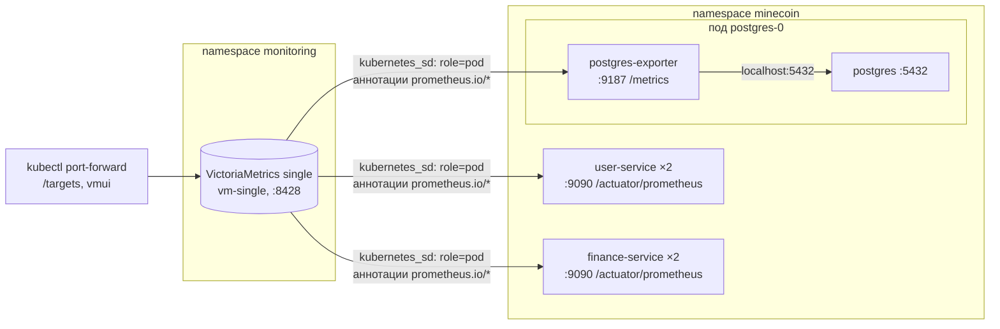

# Отчёт: метрики MineCoin в VictoriaMetrics

В тот же кластер minikube, где работает MineCoin (см. [`../Отчёт_k8s.md`](../Отчёт_k8s.md)), добавлены:
- **VictoriaMetrics single** — база временных рядов, установлена Helm-чартом; она же сама собирает метрики (scrape);
- **экспорт метрик рантайма** из `user-service` и `finance-service` — Spring Boot Actuator + Micrometer;
- **postgres-exporter** — метрики PostgreSQL;
- **бизнес-метрики** — пять собственных метрик предметной области.



Файлы:

| Файл | Что изменено |
|---|---|
| [`vmsingle-values.yaml`](vmsingle-values.yaml) | values Helm-чарта VictoriaMetrics: хранение, ресурсы, задания сбора |
| [`UserService/pom.xml`](../../UserService/pom.xml), [`FinanceService/pom.xml`](../../FinanceService/pom.xml) | зависимость `micrometer-registry-prometheus` |
| [`UserService/…/application.yml`](../../UserService/src/main/resources/application.yml), [`FinanceService/…/application.yml`](../../FinanceService/src/main/resources/application.yml) | порт управления 9090, эндпоинт `prometheus`, общая метка `application`, гистограмма HTTP-запросов, метрики Tomcat |
| `SecurityConfig.java` в обоих сервисах | `/actuator/prometheus` доступен без токена |
| [`UserService.java`](../../UserService/src/main/java/com/minecoin/user/service/UserService.java), [`WalletService.java`](../../FinanceService/src/main/java/com/minecoin/finance/service/WalletService.java) | бизнес-метрики |
| [`22_user_service.yml`](../22_user_service.yml), [`32_finance_service.yml`](../32_finance_service.yml) | порт `metrics: 9090`, пробы перенесены на 9090, аннотации `prometheus.io/*` |
| [`10_postgres.yml`](../10_postgres.yml) | второй контейнер `postgres-exporter`, аннотации `prometheus.io/*` |
| [`docker-compose.yml`](../../docker-compose.yml) | healthcheck сервисов → порт 9090 |

## 1. VictoriaMetrics через Helm

Установка — по [руководству VictoriaMetrics](https://docs.victoriametrics.com/guides/k8s-monitoring-via-vm-single/), чарт `vm/victoria-metrics-single` (версия чарта 0.49.0, VictoriaMetrics v1.154.0):

```powershell
helm repo add vm https://victoriametrics.github.io/helm-charts/
```
```powershell
helm repo update
```
```powershell
helm install vm-single vm/victoria-metrics-single -n monitoring --create-namespace -f k8s/monitoring/vmsingle-values.yaml
```

- релиз **`vm-single`** в namespace **`monitoring`**: инфраструктура мониторинга отделена от приложения, а сервис получает имя `vm-single-victoria-metrics-single-server`;
- **vmagent не ставится.** VictoriaMetrics single умеет сама собирать метрики (`server.scrape.enabled: true`), как и в руководстве. Для одного небольшого кластера отдельный агент не нужен; статус сбора виден прямо в VictoriaMetrics на странице `/targets`.

Что создаёт чарт: StatefulSet `vm-single-victoria-metrics-single-server` (1 под), headless Service (порт 8428), PVC 2 ГиБ, ConfigMap с конфигурацией сбора, а также ServiceAccount и ClusterRole с правами `get/list/watch` на `pods`, `nodes`, `endpoints`, `services` — без них VictoriaMetrics не смогла бы узнавать у API Kubernetes список подов.

### values

| Параметр | Значение | Зачем |
|---|---|---|
| `server.retentionPeriod` | `14d` | метрики хранятся две недели, потом удаляются |
| `server.persistentVolume` | 2Gi | данные переживают пересоздание пода |
| `server.resources` | requests 100m / 256Mi, limit 512Mi | чтобы планировщик учитывал VictoriaMetrics при размещении |
| `server.scrape.config.global.scrape_interval` | `15s` | как часто опрашиваются цели |
| `server.scrape.config.scrape_configs` | см. ниже | что собирать |

Задания сбора `victoriametrics`, `kubernetes-apiservers`, `kubernetes-nodes`, `kubernetes-nodes-cadvisor` взяты из values руководства (сама VictoriaMetrics, API-сервер, kubelet и cAdvisor — метрики узла и контейнеров).

**Задание `kubernetes-pods` добавлено отдельно.** В Helm списки в values не объединяются со значениями чарта, а заменяются целиком, поэтому со списком из руководства задание для подов из чарта по умолчанию пропадает. Оно и отвечает за service discovery приложений.

## 2. Service discovery по аннотациям

VictoriaMetrics с `kubernetes_sd_configs: role: pod` получает от API Kubernetes все контейнеры всех подов кластера вместе с их метаданными, а `relabel_configs` решают, какие из них опрашивать и по какому адресу:

| Правило | Что делает |
|---|---|
| `drop` по `__meta_kubernetes_pod_container_init` | init-контейнеры не опрашиваются |
| `keep_if_equal` (`prometheus.io/port` = порт контейнера) | целью становится только тот контейнер пода, у которого объявлен порт из аннотации. В поде `postgres-0` два контейнера, и без этого правила под был бы опрошен дважды |
| `keep` по `prometheus.io/scrape` = `true` | собираются только поды, которые сами об этом попросили |
| `prometheus.io/path` → `__metrics_path__` | путь к метрикам (`/actuator/prometheus` у Spring, `/metrics` у экспортера) |
| `IP пода` + `prometheus.io/port` → `__address__` | адрес опроса |
| `labelmap` меток пода, `namespace`, `pod`, `container` | метки, по которым ряды отличаются между подами и сервисами |

Аннотации ставятся в шаблон пода (`spec.template.metadata.annotations`):

| Манифест | `prometheus.io/scrape` | `prometheus.io/port` | `prometheus.io/path` |
|---|---|---|---|
| `22_user_service.yml` | `"true"` | `"9090"` | `/actuator/prometheus` |
| `32_finance_service.yml` | `"true"` | `"9090"` | `/actuator/prometheus` |
| `10_postgres.yml` | `"true"` | `"9187"` | `/metrics` |

Новые реплики подхватываются автоматически: после `kubectl scale` VictoriaMetrics сама увидит новые поды и начнёт их опрашивать, менять конфигурацию сбора не нужно. Порт метрик **не добавлен в Service**: VictoriaMetrics обращается к IP пода напрямую, а через Service и nginx метрики снаружи недоступны.

## 3. Метрики рантайма: Actuator + Micrometer

Spring Boot Actuator уже был подключён для проверок здоровья. Micrometer — встроенная в Spring Boot библиотека метрик; это фасад, как SLF4J для логов: код пишет метрики через общий API, а зависимость `micrometer-registry-prometheus` добавляет эндпоинт `/actuator/prometheus`, который отдаёт их в текстовом формате Prometheus. VictoriaMetrics этот формат понимает.

```yaml
server:
  tomcat:
    mbeanregistry:
      enabled: true
management:
  server:
    port: ${MANAGEMENT_PORT:9090}
  endpoints:
    web:
      exposure:
        include: health,info,prometheus
  metrics:
    tags:
      application: ${spring.application.name}
    distribution:
      percentiles-histogram:
        http.server.requests: true
```

- **отдельный порт управления 9090** (`management.server.port`): весь `/actuator/*` переехал с основного порта на 9090. Основной порт (8081/8082) обслуживает только API — там `/actuator/prometheus` отвечает 404. Порт 9090 не входит в Service, поэтому доступен только изнутри кластера: VictoriaMetrics и kubelet (пробы) обращаются к нему по IP пода. Поэтому пробы `startupProbe`, `livenessProbe`, `readinessProbe` в манифестах и healthcheck в `docker-compose.yml` тоже перенесены на 9090;
- **`/actuator/prometheus` без токена** (`SecurityConfig`): VictoriaMetrics не умеет получать JWT пользователя. Остальные эндпоинты Actuator, кроме `health` и `info`, наружу не открыты;
- **метка `application`** (`user-service`/`finance-service`) добавляется ко всем метрикам сервиса — по ней удобно фильтровать без знания имён подов;
- **гистограмма `http.server.requests`** — Micrometer дополнительно отдаёт ряды `http_server_requests_seconds_bucket`, по которым в VictoriaMetrics считаются перцентили времени ответа (`histogram_quantile`) с учётом всех реплик;
- **`server.tomcat.mbeanregistry.enabled`** — без этого встроенный Tomcat не публикует свои показатели, и метрики `tomcat_*` пустые.

Что экспортируется:

| Группа | Примеры метрик |
|---|---|
| JVM | `jvm_memory_used_bytes`, `jvm_gc_pause_seconds`, `jvm_threads_live_threads`, `jvm_classes_loaded_classes` |
| процесс и CPU | `process_cpu_usage`, `system_cpu_usage`, `process_uptime_seconds` |
| HTTP | `http_server_requests_seconds_count/_sum/_bucket` с метками `method`, `uri`, `status`, `outcome` |
| пул соединений с БД | `hikaricp_connections_active`, `hikaricp_connections_pending` |
| Tomcat | `tomcat_sessions_active_current_sessions`, `tomcat_threads_busy_threads` |
| логирование | `logback_events_total` по уровням |

Job миграций и создания администратора запускают то же приложение без веб-сервера, поэтому порт управления у них не поднимается и аннотаций нет.

## 4. Метрики PostgreSQL: postgres-exporter

[postgres-exporter](https://github.com/prometheus-community/postgres_exporter) — стандартный экспортер Prometheus для PostgreSQL: подключается к базе, выполняет запросы к системным представлениям (`pg_stat_database`, `pg_stat_activity`, `pg_locks` и т.д.) и отдаёт результат на `:9187/metrics`.

Он запущен **вторым контейнером в поде `postgres-0`** (sidecar):
- контейнеры одного пода делят сетевое пространство, поэтому экспортер подключается к базе по `localhost:5432` (`DATA_SOURCE_URI=localhost:5432/postgres?sslmode=disable`) и не зависит от DNS и Service;
- экспортер живёт и перезапускается вместе с базой, отдельного Deployment не нужно;
- пользователь — `postgres`, пароль — из Secret `minecoin-secrets` (`POSTGRES_PASSWORD`). Для продакшена правильнее отдельный пользователь с ролью `pg_monitor` и только правами чтения статистики, но это потребовало бы изменить init-скрипт базы и пересоздать её том;
- образ закреплён на версии `prometheuscommunity/postgres-exporter:v0.20.1`; readiness-проба — `GET /metrics`; ресурсы 20m / 32Mi, лимит 64Mi.

Основные метрики: `pg_up` (экспортер смог подключиться к базе), `pg_stat_database_xact_commit` / `_xact_rollback` (транзакции по базам `users_db`, `finance_db`), `pg_stat_database_blks_hit` / `_blks_read` (попадания в кэш), `pg_stat_database_deadlocks`, `pg_stat_activity_count` (соединения), `pg_database_size_bytes`, `pg_locks_count`.

## 5. Бизнес-метрики

Метрики создаются прямо в слое `service`: `MeterRegistry` из Micrometer внедряется в конструкторы `UserService` и `WalletService` (поле `metrics`), например:
```java
metrics.counter("minecoin.auth.logins", "result", "success").increment();
```
Имена в коде пишутся через точку, при экспорте Micrometer превращает их в имена Prometheus: `minecoin.auth.logins` → `minecoin_auth_logins_total`.

| Метрика | Тип | Метки | Сервис | Что показывает |
|---|---|---|---|---|
| `minecoin_auth_registrations_total` | Counter | — | user-service | приток новых пользователей |
| `minecoin_auth_logins_total` | Counter | `result`: `success`, `invalid_credentials`, `user_blocked` | user-service | попытки входа; всплеск неудачных — признак подбора пароля |
| `minecoin_wallet_operations_total` | Counter | `type`: `deposit`, `withdraw`; `result`: `success`, `insufficient_funds`, `amount_limit_exceeded` | finance-service | пополнения и снятия и причины отказов |
| `minecoin_wallet_transfers_total` | Counter | `result`: `success`, `insufficient_funds`, `amount_limit_exceeded`, `recipient_not_found`, `self_transfer`, `user_service_unavailable` | finance-service | переводы между пользователями и причины отказов, в том числе недоступность `user-service` |
| `minecoin_wallet_operation_amount` (`_count`, `_sum`, `_max`) | Distribution summary | `type`: `deposit`, `withdraw`, `transfer` | finance-service | объём денег в MNC по успешным операциям: сколько пополнили, сняли, перевели, средняя сумма |

- **Значение `result` = код ошибки API в нижнем регистре** (`INSUFFICIENT_FUNDS` → `insufficient_funds`): отказ считается в месте, где возникает доменное исключение, после чего исключение пробрасывается дальше, поведение API не меняется. Поэтому метрику легко сопоставить с ответами API и логами.
- **Операции с одним кошельком и переводы — разные метрики:** у перевода свои причины отказа (получатель не найден, перевод себе, `user-service` недоступен).
- **Успех считается после фиксации транзакции.** Пополнение и снятие выполняются через `TransactionTemplate`, как и перевод, и счётчик `success` увеличивается только после успешного коммита.
- Метки принимают только фиксированный набор значений (без логинов и сумм), поэтому число рядов не растёт с числом пользователей.
- Счётчики хранятся в памяти каждой реплики и обнуляются при перезапуске пода. `rate`/`increase` учитывают сброс счётчика, а `sum` складывает значения всех реплик.
- **Сознательно не сделано:** gauge «сумма балансов всех кошельков». Его считала бы каждая реплика одним и тем же запросом к базе, и при двух репликах значение дублировалось бы.

Счётчики проверяются интеграционными тестами: `UserApiIT.registrationsAndLoginOutcomesAreCounted`, `WalletServiceIT.operationsAndTransfersAreCountedByResult`.

Примеры запросов (MetricsQL):

| Запрос | Что показывает |
|---|---|
| `sum by (result) (rate(minecoin_auth_logins_total[5m]))` | входов в секунду по результату |
| `sum by (type, result) (increase(minecoin_wallet_operations_total[1h]))` | пополнения и снятия за час, успешные и отклонённые |
| `sum(rate(minecoin_wallet_transfers_total{result!="success"}[5m])) / sum(rate(minecoin_wallet_transfers_total[5m]))` | доля неуспешных переводов |
| `sum by (type) (increase(minecoin_wallet_operation_amount_sum[1h]))` | оборот MNC за час по типам операций |
| `sum(rate(minecoin_wallet_operation_amount_sum{type="transfer"}[1h])) / sum(rate(minecoin_wallet_operation_amount_count{type="transfer"}[1h]))` | средняя сумма перевода |

## 6. Ресурсы

| Компонент | CPU requests | RAM requests | RAM limits |
|---|---|---|---|
| VictoriaMetrics single | 100m | 256Mi | 512Mi |
| postgres-exporter | 20m | 32Mi | 64Mi |

Вместе с приложением, логированием и системными подами в `requests` получается ~2,5 CPU и ~2,9 ГиБ — кластер из [раздела 0 отчёта по Kubernetes](../Отчёт_k8s.md) (4 CPU, 6 ГиБ) их вмещает.

## 7. Развёртывание и проверка

Команды выполняются из корня репозитория в PowerShell от имени администратора; приложение уже развёрнуто по [`../Отчёт_k8s.md`](../Отчёт_k8s.md).

1. VictoriaMetrics — команды из раздела 1.
2. Пересобрать образы сервисов в Docker-демоне minikube и применить изменённые манифесты:
```powershell
& minikube -p minikube docker-env --shell powershell | Invoke-Expression
```
```powershell
docker compose build user-migrate finance-migrate
```
```powershell
kubectl apply -f k8s/10_postgres.yml -f k8s/22_user_service.yml -f k8s/32_finance_service.yml
```
```powershell
kubectl rollout status deployment/user-service -n minecoin
```
```powershell
kubectl rollout status deployment/finance-service -n minecoin
```
3. Поды и сервис VictoriaMetrics:
```powershell
kubectl get pods,svc,pvc -n monitoring
```
4. Доступ к VictoriaMetrics:
```powershell
kubectl port-forward svc/vm-single-victoria-metrics-single-server 8428:8428 -n monitoring
```
- `http://localhost:8428/targets` — состояние сбора: в задании `kubernetes-pods` пять целей в состоянии `up` (2 × `user-service`, 2 × `finance-service`, `postgres-exporter`);
- `http://localhost:8428/vmui/` — веб-интерфейс для запросов;
- список собранных метрик:
```powershell
curl.exe "http://localhost:8428/api/v1/label/__name__/values"
```
5. Сделать в приложении несколько действий (вход с неверным паролем, пополнение, снятие больше баланса, перевод несуществующему пользователю) и выполнить запросы в vmui:
- `up{job="kubernetes-pods"}` — все цели опрашиваются;
- `jvm_memory_used_bytes{application="finance-service", area="heap"}` — метрики рантайма;
- `pg_up`, `pg_stat_database_xact_commit{datname=~"users_db|finance_db"}` — метрики PostgreSQL;
- `minecoin_auth_logins_total`, `sum by (type, result) (minecoin_wallet_operations_total)`, `sum by (result) (minecoin_wallet_transfers_total)` — бизнес-метрики.

Удалить VictoriaMetrics вместе с данными:
```powershell
helm uninstall vm-single -n monitoring
```
```powershell
kubectl delete namespace monitoring
```
