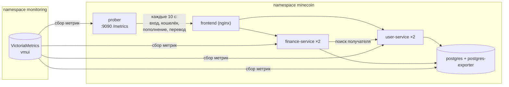

# Отчёт: SLI, SLO и SLA для MineCoin

Работа продолжает [отчёт по метрикам](../monitoring/Отчёт.md): метрики, которые VictoriaMetrics уже собирает с
`user-service`, `finance-service` и `postgres-exporter`, становятся показателями качества. В кластер добавлен
**пробер** — отдельное приложение, которое проверяет MineCoin снаружи, как пользователь. Графики строятся в vmui.



## 1. Формулировки

- **SLI** (Service Level Indicator) — измеряемый показатель качества. Здесь это всегда доля «хорошего»:
  `хорошие события / все события`, от 0 до 1.
- **SLO** (Service Level Objective) — внутренняя цель для SLI на окне времени, например «SLI ≥ 99,5 % за 30 дней».
- **Бюджет ошибок** — сколько «плохого» разрешает SLO: `1 − SLO`. Остаток бюджета считается как
  `1 − (1 − SLI за окно) / (1 − SLO)`: 1 — бюджет не тронут, 0 — израсходован, меньше 0 — SLO нарушен.
- **Скорость расхода бюджета** (burn rate) — во сколько раз текущая доля ошибок больше допустимой:
  `(1 − SLI за 5 мин) / (1 − SLO)`. При 1 бюджет закончится ровно к концу окна, при 10 — в 10 раз быстрее.
- **SLA** (Service Level Agreement) — обещание пользователям с последствиями при нарушении. Он мягче SLO, чтобы
  команда узнавала о проблеме раньше, чем нарушится договор.
- **RBSLO** (по запросам) — доля успешных запросов. **TBSLO** (по времени) — каждая минута отмечается хорошей или
  плохой, считается доля хороших минут.

## 2. Выбранные метрики

Из метрик предыдущего ДЗ 4 взяты три:

- `http_server_requests_seconds` — запросы к API обоих сервисов (Micrometer): количество, статус, время ответа;
- `minecoin_wallet_transfers_total` — бизнес-метрика переводов с меткой `result`;
- `pg_up` — доступность PostgreSQL от postgres-exporter.

Новая метрика — от пробера, `minecoin_prober_runs_total` (раздел 5).

Серверные метрики считает сам сервис. Если сервис или база недоступны, запросы до него не доходят, и серверные SLI
почти не меняются: ошибок нет, потому что нет и запросов. Пробер смотрит снаружи, через `frontend`, и видит отказ
сразу. Поэтому набор SLI сочетает оба взгляда.

## 3. SLI и SLO

Текущее значение каждого SLI считается на окне 5 минут. SLO формулируется на окне 30 дней; для демонстрации на
графиках используется окно 1 час, потому что за время скринкаста 30-дневное окно почти не сдвинется. Срок хранения
метрик поднят до 31 дня (`retentionPeriod` в [`vmsingle-values.yaml`](../monitoring/vmsingle-values.yaml)), чтобы
окно в 30 дней помещалось в хранилище.

| SLI | Что меряет | Тип | SLO за 30 дней | Бюджет ошибок за 30 дней |
|---|---|---|---|---|
| SLI-1 | доступность API | RBSLO | ≥ 99,5 % | 0,5 % запросов |
| SLI-2 | задержка API | RBSLO | ≥ 95 % быстрее 300 мс | 5 % запросов |
| SLI-3 | успешность переводов | RBSLO | ≥ 99 % | 1 % переводов |
| SLI-4 | доступность базы | TBSLO | ≥ 99,9 % минут | ~43 минуты |
| SLI-5 | сценарий пользователя (пробер) | TBSLO | ≥ 99,5 % минут | ~3,6 часа |

### SLI-1. Доступность API

Хороший запрос — ответ не 5xx. Ответы 4xx (неверный пароль, нехватка денег) — ошибка пользователя, сервис отработал
правильно.

```
sum(rate(http_server_requests_seconds_count{namespace="minecoin", status!~"5.."}[5m]))
/
sum(rate(http_server_requests_seconds_count{namespace="minecoin"}[5m]))
```

**SLO:** не менее 99,5 % запросов к API за 30 дней завершаются без ошибки сервера.

### SLI-2. Задержка API

Хороший запрос — обработан быстрее 300 мс. Считаются только ответы без 5xx: отказы уже учтены в SLI-1, а SLI-2
говорит о скорости работающего сервиса. Без этого фильтра при отказе `user-service` медленные ответы 503 роняли бы и
задержку, и два разных сбоя было бы не различить.

```
sum(rate(http_server_requests_seconds_bucket{namespace="minecoin", status!~"5..", le="0.3"}[5m]))
/
sum(rate(http_server_requests_seconds_count{namespace="minecoin", status!~"5.."}[5m]))
```

**SLO:** не менее 95 % успешных запросов к API за 30 дней обрабатываются быстрее 300 мс.

### SLI-3. Успешность переводов

Плохой перевод — отказ по вине системы, `result="user_service_unavailable"`: `finance-service` не смог проверить
получателя в `user-service`. Отказы `insufficient_funds`, `recipient_not_found`, `self_transfer`,
`amount_limit_exceeded` — ошибки пользователя.

```
1 - (sum(rate(minecoin_wallet_transfers_total{result="user_service_unavailable"}[5m])) or vector(0))
    / sum(rate(minecoin_wallet_transfers_total[5m]))
```

**SLO:** не менее 99 % переводов за 30 дней не отклоняются из-за недоступности сервисов.

### SLI-4. Доступность базы

Хорошая минута — `pg_up = 1`. Если под `postgres-0` пропал целиком, вместе с ним пропадает postgres-exporter и ряда
`pg_up` нет совсем; `or vector(0)` считает такую минуту плохой. Условие `and on() (…)` отбрасывает минуты, когда
мониторинга ещё не было, — иначе они тоже считались бы плохими.

Индикатор минуты:
```
(max(pg_up) or vector(0)) and on() (max(minecoin_prober_runs_total) >= 0)
```

**SLO:** не менее 99,9 % минут за 30 дней база доступна (около 43 минут простоя в месяц).

### SLI-5. Сценарий пользователя

Хорошая минута — за минуту был хотя бы один успешный прогон пробера и ни одного неуспешного.

Индикатор минуты:
```
(
  ((sum(increase(minecoin_prober_runs_total{result="failure"}[1m])) or vector(0)) == bool 0)
  *
  ((sum(increase(minecoin_prober_runs_total{result="success"}[1m])) or vector(0)) > bool 0)
) and on() (max(minecoin_prober_runs_total) >= 0)
```

**SLO:** не менее 99,5 % минут за 30 дней пользовательский сценарий проходит целиком.

### Выполнение SLO на окне

Для RBSLO хорошие и все события суммируются за окно `T`, для TBSLO усредняется индикатор минуты:

```
# SLI-1, аналогично SLI-2 и SLI-3
sum(increase(http_server_requests_seconds_count{namespace="minecoin", status!~"5.."}[30d]))
/
sum(increase(http_server_requests_seconds_count{namespace="minecoin"}[30d]))

# SLI-4 и SLI-5
avg_over_time((индикатор минуты)[30d:1m])
```

SLO выполнен, если результат не меньше цели. На графиках вместо `30d` стоит `1h`. Окно 30 дней лучше смотреть
вкладкой Table в vmui (одно значение на текущий момент): подзапрос `[30d:1m]` — это 43 200 точек на каждую точку
графика.

## 4. SLA

**SLA приложения.** Сервис MineCoin (вход, кошелёк, пополнение, переводы) доступен не менее **99 %** времени в
календарный месяц. Доступность измеряется пробером: минута доступна, если сценарий пользователя прошёл целиком. При
доступности ниже 99 % пользователь получает компенсацию 10 % месячной платы, ниже 95 % — 25 %.

```
avg_over_time((индикатор минуты SLI-5)[30d:1m]) >= 0.99
```

SLA построен на том же индикаторе, что и SLI-5, но с более мягкой целью: 99 % против 99,5 %. Внутренний SLO
нарушится раньше, и у команды будет запас (~3,6 часа в месяц) до нарушения обещания.

**Общий SLA для набора SLO.** Минута хорошая, только если одновременно выполнены условия: SLI-1 ≥ 99,5 % и SLI-2 ≥
95 % на окне 5 минут, база доступна, прогоны пробера успешны. Обещание — не менее 99 % таких минут в месяц.

```
avg_over_time((
    ((SLI-1) >= bool 0.995 or vector(0))
  * ((SLI-2) >= bool 0.95 or vector(0))
  * (индикатор минуты SLI-4)
  * (индикатор минуты SLI-5)
)[30d:1m])
```

Сравнение `>= bool` возвращает 1 или 0, поэтому произведение равно 1, только когда все условия выполнены.
Общий SLA строже SLA по проберу: он замечает и медленную работу (SLI-2), которую пробер не считает отказом.

## 5. Пробер

Свой пробер на Java (модуль [`Prober`](../../Prober)) выбран вместо готового blackbox_exporter: blackbox_exporter
умеет только запросы без авторизации, а для проверки кошелька и переводов нужно войти и получить JWT.

Пробер — Java-приложение без Spring: встроенный `HttpClient`, метрики Micrometer на `/metrics` (порт 9090),
запуск по расписанию каждые 10 секунд. Он ходит через `frontend` (`http://frontend.minecoin.svc.cluster.local`), то
есть проверяет nginx, оба сервиса и базу.

Один прогон:

1. `frontend` — `GET /`.
2. `login` — вход пользователем `prober`, полученный токен запоминается.
3. `wallet` — `GET /api/wallets/me`.
4. `deposit` — пополнение на 1 MNC.
5. `transfer` — перевод 1 MNC пользователю `prober_sink`.

Прогон успешен, только если прошли все шаги. Пользователей `prober` и `prober_sink` пробер регистрирует сам при
первом запуске, пароль берётся из ключа `PROBER_PASSWORD` в секрете `minecoin-secrets`. Баланс пробера не растёт:
+1 и −1 за прогон.

Если упал `user-service`, шаг `login` не проходит, но шаги кошелька выполняются со старым токеном. Перевод доходит до
`finance-service` и получает «user-service недоступен», поэтому отказ виден сразу и в SLI-5, и в SLI-3.

Метрики пробера:

- `minecoin_prober_runs_total{result}` — прогоны целиком (`success` / `failure`), на них построены SLI-5 и SLA;
- `minecoin_prober_checks_total{step, result}` — каждый шаг отдельно: видно, что именно сломалось;
- `minecoin_prober_check_duration_seconds{step}` — время каждого шага.

VictoriaMetrics находит пробер сама по аннотациям `prometheus.io/*` в [`50_prober.yml`](../50_prober.yml), как сервисы
в ДЗ 4. Ресурсы пода: 50m CPU и 96Mi в `requests`, 160Mi в `limits`.

Побочный эффект: пробер каждые 10 секунд делает пополнение и перевод, поэтому бизнес-счётчики ДЗ 4
(`minecoin_wallet_operations_total`, `minecoin_wallet_transfers_total`) растут и без пользователей.

## 6. Графики

Ссылки открывают vmui с готовым запросом за последний час; нужен проброс порта:

```powershell
kubectl port-forward svc/vm-single-victoria-metrics-single-server 8428:8428 -n monitoring
```

Все линии одного графика собраны в один запрос через `union(label_set(…, "sli", "…"), …)`: так у каждой линии своё
имя в легенде.

1. [Текущие значения SLI](http://localhost:8428/vmui/#/?g0.expr=union%28%0A%20%20label_set%28sum%28rate%28http_server_requests_seconds_count%7Bnamespace%3D%22minecoin%22%2C%20status%21~%225..%22%7D%5B5m%5D%29%29%20%2F%20sum%28rate%28http_server_requests_seconds_count%7Bnamespace%3D%22minecoin%22%7D%5B5m%5D%29%29%2C%20%22sli%22%2C%20%22SLI-1%20availability%22%29%2C%0A%20%20label_set%28sum%28rate%28http_server_requests_seconds_bucket%7Bnamespace%3D%22minecoin%22%2C%20status%21~%225..%22%2C%20le%3D%220.3%22%7D%5B5m%5D%29%29%20%2F%20sum%28rate%28http_server_requests_seconds_count%7Bnamespace%3D%22minecoin%22%2C%20status%21~%225..%22%7D%5B5m%5D%29%29%2C%20%22sli%22%2C%20%22SLI-2%20latency%3C300ms%22%29%2C%0A%20%20label_set%281%20-%20%28sum%28rate%28minecoin_wallet_transfers_total%7Bresult%3D%22user_service_unavailable%22%7D%5B5m%5D%29%29%20or%20vector%280%29%29%20%2F%20sum%28rate%28minecoin_wallet_transfers_total%5B5m%5D%29%29%2C%20%22sli%22%2C%20%22SLI-3%20transfers%22%29%2C%0A%20%20label_set%28avg_over_time%28%28%28max%28pg_up%29%20or%20vector%280%29%29%20and%20on%28%29%20%28max%28minecoin_prober_runs_total%29%20%3E%3D%200%29%29%5B5m%3A1m%5D%29%2C%20%22sli%22%2C%20%22SLI-4%20postgres%22%29%2C%0A%20%20label_set%28avg_over_time%28%28%28%28%28sum%28increase%28minecoin_prober_runs_total%7Bresult%3D%22failure%22%7D%5B1m%5D%29%29%20or%20vector%280%29%29%20%3D%3D%20bool%200%29%20%2A%20%28%28sum%28increase%28minecoin_prober_runs_total%7Bresult%3D%22success%22%7D%5B1m%5D%29%29%20or%20vector%280%29%29%20%3E%20bool%200%29%29%20and%20on%28%29%20%28max%28minecoin_prober_runs_total%29%20%3E%3D%200%29%29%5B5m%3A1m%5D%29%2C%20%22sli%22%2C%20%22SLI-5%20prober%22%29%0A%29&g0.range_input=1h&g0.relative_time=last_1h&g0.tab=0&g0.step_input=30s) — пять SLI на окне 5 минут, от 0 до 1. Для SLI-4 и SLI-5 — доля хороших минут
   за последние 5 минут.
2. [Выполнение SLO за окно 1 час](http://localhost:8428/vmui/#/?g0.expr=union%28%0A%20%20label_set%28sum%28increase%28http_server_requests_seconds_count%7Bnamespace%3D%22minecoin%22%2C%20status%21~%225..%22%7D%5B1h%5D%29%29%20%2F%20sum%28increase%28http_server_requests_seconds_count%7Bnamespace%3D%22minecoin%22%7D%5B1h%5D%29%29%2C%20%22sli%22%2C%20%22SLI-1%20availability%22%29%2C%0A%20%20label_set%28sum%28increase%28http_server_requests_seconds_bucket%7Bnamespace%3D%22minecoin%22%2C%20status%21~%225..%22%2C%20le%3D%220.3%22%7D%5B1h%5D%29%29%20%2F%20sum%28increase%28http_server_requests_seconds_count%7Bnamespace%3D%22minecoin%22%2C%20status%21~%225..%22%7D%5B1h%5D%29%29%2C%20%22sli%22%2C%20%22SLI-2%20latency%3C300ms%22%29%2C%0A%20%20label_set%281%20-%20%28sum%28increase%28minecoin_wallet_transfers_total%7Bresult%3D%22user_service_unavailable%22%7D%5B1h%5D%29%29%20or%20vector%280%29%29%20%2F%20sum%28increase%28minecoin_wallet_transfers_total%5B1h%5D%29%29%2C%20%22sli%22%2C%20%22SLI-3%20transfers%22%29%2C%0A%20%20label_set%28avg_over_time%28%28%28max%28pg_up%29%20or%20vector%280%29%29%20and%20on%28%29%20%28max%28minecoin_prober_runs_total%29%20%3E%3D%200%29%29%5B1h%3A1m%5D%29%2C%20%22sli%22%2C%20%22SLI-4%20postgres%22%29%2C%0A%20%20label_set%28avg_over_time%28%28%28%28%28sum%28increase%28minecoin_prober_runs_total%7Bresult%3D%22failure%22%7D%5B1m%5D%29%29%20or%20vector%280%29%29%20%3D%3D%20bool%200%29%20%2A%20%28%28sum%28increase%28minecoin_prober_runs_total%7Bresult%3D%22success%22%7D%5B1m%5D%29%29%20or%20vector%280%29%29%20%3E%20bool%200%29%29%20and%20on%28%29%20%28max%28minecoin_prober_runs_total%29%20%3E%3D%200%29%29%5B1h%3A1m%5D%29%2C%20%22sli%22%2C%20%22SLI-5%20prober%22%29%0A%29&g0.range_input=1h&g0.relative_time=last_1h&g0.tab=0&g0.step_input=30s) — SLI за последний час; сравнивается с целью из таблицы раздела 3.
3. [Остаток бюджета ошибок](http://localhost:8428/vmui/#/?g0.expr=union%28%0A%20%20label_set%28clamp_min%281%20-%20%281%20-%20%28sum%28increase%28http_server_requests_seconds_count%7Bnamespace%3D%22minecoin%22%2C%20status%21~%225..%22%7D%5B1h%5D%29%29%20%2F%20sum%28increase%28http_server_requests_seconds_count%7Bnamespace%3D%22minecoin%22%7D%5B1h%5D%29%29%29%29%20%2F%20%281%20-%200.995%29%2C%20-1%29%2C%20%22sli%22%2C%20%22SLI-1%20availability%22%29%2C%0A%20%20label_set%28clamp_min%281%20-%20%281%20-%20%28sum%28increase%28http_server_requests_seconds_bucket%7Bnamespace%3D%22minecoin%22%2C%20status%21~%225..%22%2C%20le%3D%220.3%22%7D%5B1h%5D%29%29%20%2F%20sum%28increase%28http_server_requests_seconds_count%7Bnamespace%3D%22minecoin%22%2C%20status%21~%225..%22%7D%5B1h%5D%29%29%29%29%20%2F%20%281%20-%200.95%29%2C%20-1%29%2C%20%22sli%22%2C%20%22SLI-2%20latency%3C300ms%22%29%2C%0A%20%20label_set%28clamp_min%281%20-%20%281%20-%20%281%20-%20%28sum%28increase%28minecoin_wallet_transfers_total%7Bresult%3D%22user_service_unavailable%22%7D%5B1h%5D%29%29%20or%20vector%280%29%29%20%2F%20sum%28increase%28minecoin_wallet_transfers_total%5B1h%5D%29%29%29%29%20%2F%20%281%20-%200.99%29%2C%20-1%29%2C%20%22sli%22%2C%20%22SLI-3%20transfers%22%29%2C%0A%20%20label_set%28clamp_min%281%20-%20%281%20-%20%28avg_over_time%28%28%28max%28pg_up%29%20or%20vector%280%29%29%20and%20on%28%29%20%28max%28minecoin_prober_runs_total%29%20%3E%3D%200%29%29%5B1h%3A1m%5D%29%29%29%20%2F%20%281%20-%200.999%29%2C%20-1%29%2C%20%22sli%22%2C%20%22SLI-4%20postgres%22%29%2C%0A%20%20label_set%28clamp_min%281%20-%20%281%20-%20%28avg_over_time%28%28%28%28%28sum%28increase%28minecoin_prober_runs_total%7Bresult%3D%22failure%22%7D%5B1m%5D%29%29%20or%20vector%280%29%29%20%3D%3D%20bool%200%29%20%2A%20%28%28sum%28increase%28minecoin_prober_runs_total%7Bresult%3D%22success%22%7D%5B1m%5D%29%29%20or%20vector%280%29%29%20%3E%20bool%200%29%29%20and%20on%28%29%20%28max%28minecoin_prober_runs_total%29%20%3E%3D%200%29%29%5B1h%3A1m%5D%29%29%29%20%2F%20%281%20-%200.995%29%2C%20-1%29%2C%20%22sli%22%2C%20%22SLI-5%20prober%22%29%0A%29&g0.range_input=1h&g0.relative_time=last_1h&g0.tab=0&g0.step_input=30s) — `1 − (1 − SLI за 1 ч) / (1 − SLO)`. Значение ограничено снизу −1 (бюджет
   перерасходован вдвое и больше): на часовом окне бюджет крошечный, при цели 99,5 % это 18 секунд, и одна плохая
   минута без ограничения дала бы −2,3, а при долгом отказе — десятки.
4. [Скорость расхода бюджета](http://localhost:8428/vmui/#/?g0.expr=union%28%0A%20%20label_set%28%281%20-%20%28sum%28rate%28http_server_requests_seconds_count%7Bnamespace%3D%22minecoin%22%2C%20status%21~%225..%22%7D%5B5m%5D%29%29%20%2F%20sum%28rate%28http_server_requests_seconds_count%7Bnamespace%3D%22minecoin%22%7D%5B5m%5D%29%29%29%29%20%2F%20%281%20-%200.995%29%2C%20%22sli%22%2C%20%22SLI-1%20availability%22%29%2C%0A%20%20label_set%28%281%20-%20%28sum%28rate%28http_server_requests_seconds_bucket%7Bnamespace%3D%22minecoin%22%2C%20status%21~%225..%22%2C%20le%3D%220.3%22%7D%5B5m%5D%29%29%20%2F%20sum%28rate%28http_server_requests_seconds_count%7Bnamespace%3D%22minecoin%22%2C%20status%21~%225..%22%7D%5B5m%5D%29%29%29%29%20%2F%20%281%20-%200.95%29%2C%20%22sli%22%2C%20%22SLI-2%20latency%3C300ms%22%29%2C%0A%20%20label_set%28%281%20-%20%281%20-%20%28sum%28rate%28minecoin_wallet_transfers_total%7Bresult%3D%22user_service_unavailable%22%7D%5B5m%5D%29%29%20or%20vector%280%29%29%20%2F%20sum%28rate%28minecoin_wallet_transfers_total%5B5m%5D%29%29%29%29%20%2F%20%281%20-%200.99%29%2C%20%22sli%22%2C%20%22SLI-3%20transfers%22%29%2C%0A%20%20label_set%28%281%20-%20%28avg_over_time%28%28%28max%28pg_up%29%20or%20vector%280%29%29%20and%20on%28%29%20%28max%28minecoin_prober_runs_total%29%20%3E%3D%200%29%29%5B5m%3A1m%5D%29%29%29%20%2F%20%281%20-%200.999%29%2C%20%22sli%22%2C%20%22SLI-4%20postgres%22%29%2C%0A%20%20label_set%28%281%20-%20%28avg_over_time%28%28%28%28%28sum%28increase%28minecoin_prober_runs_total%7Bresult%3D%22failure%22%7D%5B1m%5D%29%29%20or%20vector%280%29%29%20%3D%3D%20bool%200%29%20%2A%20%28%28sum%28increase%28minecoin_prober_runs_total%7Bresult%3D%22success%22%7D%5B1m%5D%29%29%20or%20vector%280%29%29%20%3E%20bool%200%29%29%20and%20on%28%29%20%28max%28minecoin_prober_runs_total%29%20%3E%3D%200%29%29%5B5m%3A1m%5D%29%29%29%20%2F%20%281%20-%200.995%29%2C%20%22sli%22%2C%20%22SLI-5%20prober%22%29%0A%29&g0.range_input=1h&g0.relative_time=last_1h&g0.tab=0&g0.step_input=30s) — `(1 − SLI за 5 мин) / (1 − SLO)`. В норме 0, при отказе — десятки и сотни.
5. [SLA](http://localhost:8428/vmui/#/?g0.expr=union%28%0A%20%20label_set%28avg_over_time%28%28%28%28%28sum%28increase%28minecoin_prober_runs_total%7Bresult%3D%22failure%22%7D%5B1m%5D%29%29%20or%20vector%280%29%29%20%3D%3D%20bool%200%29%20%2A%20%28%28sum%28increase%28minecoin_prober_runs_total%7Bresult%3D%22success%22%7D%5B1m%5D%29%29%20or%20vector%280%29%29%20%3E%20bool%200%29%29%20and%20on%28%29%20%28max%28minecoin_prober_runs_total%29%20%3E%3D%200%29%29%5B1h%3A1m%5D%29%2C%20%22sli%22%2C%20%22SLA%20prober%20%28target%200.99%29%22%29%2C%0A%20%20label_set%28avg_over_time%28%28%28%28sum%28rate%28http_server_requests_seconds_count%7Bnamespace%3D%22minecoin%22%2C%20status%21~%225..%22%7D%5B5m%5D%29%29%20%2F%20sum%28rate%28http_server_requests_seconds_count%7Bnamespace%3D%22minecoin%22%7D%5B5m%5D%29%29%29%20%3E%3D%20bool%200.995%20or%20vector%280%29%29%20%2A%20%28%28sum%28rate%28http_server_requests_seconds_bucket%7Bnamespace%3D%22minecoin%22%2C%20status%21~%225..%22%2C%20le%3D%220.3%22%7D%5B5m%5D%29%29%20%2F%20sum%28rate%28http_server_requests_seconds_count%7Bnamespace%3D%22minecoin%22%2C%20status%21~%225..%22%7D%5B5m%5D%29%29%29%20%3E%3D%20bool%200.95%20or%20vector%280%29%29%20%2A%20%28%28max%28pg_up%29%20or%20vector%280%29%29%20and%20on%28%29%20%28max%28minecoin_prober_runs_total%29%20%3E%3D%200%29%29%20%2A%20%28%28%28%28sum%28increase%28minecoin_prober_runs_total%7Bresult%3D%22failure%22%7D%5B1m%5D%29%29%20or%20vector%280%29%29%20%3D%3D%20bool%200%29%20%2A%20%28%28sum%28increase%28minecoin_prober_runs_total%7Bresult%3D%22success%22%7D%5B1m%5D%29%29%20or%20vector%280%29%29%20%3E%20bool%200%29%29%20and%20on%28%29%20%28max%28minecoin_prober_runs_total%29%20%3E%3D%200%29%29%29%5B1h%3A1m%5D%29%2C%20%22sli%22%2C%20%22overall%20SLA%20%28target%200.99%29%22%29%2C%0A%20%20label_set%28vector%280.99%29%2C%20%22sli%22%2C%20%22target%22%29%0A%29&g0.range_input=1h&g0.relative_time=last_1h&g0.tab=0&g0.step_input=30s) — доля хороших минут по проберу и общий SLA за час, линия цели 0,99.
6. [Ошибки пробера по шагам](http://localhost:8428/vmui/#/?g0.expr=sum%20by%20%28step%29%20%28increase%28minecoin_prober_checks_total%7Bresult%3D%22failure%22%7D%5B1m%5D%29%29&g0.range_input=1h&g0.relative_time=last_1h&g0.tab=0&g0.step_input=30s) — сколько раз за минуту не прошёл каждый шаг.
7. [Время шагов пробера](http://localhost:8428/vmui/#/?g0.expr=sum%20by%20%28step%29%20%28rate%28minecoin_prober_check_duration_seconds_sum%5B1m%5D%29%29%20%2F%20sum%20by%20%28step%29%20%28rate%28minecoin_prober_check_duration_seconds_count%5B1m%5D%29%29&g0.range_input=1h&g0.relative_time=last_1h&g0.tab=0&g0.step_input=30s) — среднее время каждого шага, в секундах.

## 7. Изменения приложения

- **Корзины 100 мс, 300 мс и 1 с в гистограмме запросов.** Гистограмма Micrometer режет время ответа на свои
  интервалы, и ровно 300 мс среди них нет. В `application.yml` обоих сервисов добавлено:
  ```yaml
  management:
    metrics:
      distribution:
        slo:
          http.server.requests: 100ms,300ms,1s
  ```
  Появились корзины `le="0.1"`, `le="0.3"` и `le="1.0"`, по которым считается SLI-2. Запросы к actuator (порт 9090)
  в `http_server_requests` не попадают, поэтому фильтр по `uri` не нужен.
- **Пробер** — модуль [`Prober`](../../Prober), манифест [`50_prober.yml`](../50_prober.yml), сборка в
  [`deploy.ps1`](../deploy.ps1) и сервис `prober` в `docker-compose.yml` (раздел 5).
- **Инъекция сбоев в `finance-service`** — чтобы на скринкасте показать замедление и ошибки без правки кода. Две
  переменные окружения, по умолчанию выключены (`0ms` и `0` в ConfigMap
  [`30_finance_service_config.yml`](../30_finance_service_config.yml)):
  - `FAULT_DELAY` — задержка перед каждым запросом `/api/**`, например `500ms`;
  - `FAULT_ERROR_RATE` — доля запросов, на которые сервис отвечает `500` с `code: INJECTED_FAULT`, например `0.3`.

  Реализация — перехватчик Spring MVC
  ([`FaultInjectionInterceptor`](../../FinanceService/src/main/java/com/minecoin/finance/infrastructure/fault/FaultInjectionInterceptor.java)).
  Он срабатывает после выбора метода контроллера, поэтому ошибки попадают в метрики с настоящим `uri`, а задержка —
  во время ответа. При включении сервис пишет в лог `Fault injection enabled: delay …, error rate …`.

## 8. Сценарии для скринкаста

Перед записью приложение должно проработать в норме не меньше часа: тогда все SLI и SLO за час равны 1, а бюджет
цел. Сразу после развёртывания SLI-5 может показывать одну плохую минуту: если VictoriaMetrics начала собирать
метрики позже пробера, его ошибки при старте попадают в первую минуту, потому что VictoriaMetrics считает первое
появление ряда приростом от 0.

Каждый сценарий длится 3–5 минут, потом всё возвращается в норму. После каждого видно, что текущие SLI
восстанавливаются, а SLO за час и остаток бюджета остаются ниже: потраченный бюджет не возвращается.

### 1. Отказ `user-service`

```powershell
kubectl scale deployment/user-service --replicas=0 -n minecoin
```
```powershell
kubectl scale deployment/user-service --replicas=2 -n minecoin
```

Что видно: SLI-5 и SLA падают до 0 (не проходит вход). SLI-3 резко падает: переводы со старым токеном отклоняются с
`user_service_unavailable`. SLI-1 снижается: `finance-service` отвечает 503 на переводы. Серверные метрики
`user-service` пропадают — без пробера отказ входа на графиках SLI-1 был бы почти не виден. При локальной проверке
за 2 минуты отказа: SLI-1 ≈ 0,86, SLI-3 ≈ 0,46, SLI-5 = 0.

### 2. Замедление `finance-service`

```powershell
kubectl set env deployment/finance-service FAULT_DELAY=500ms -n minecoin
```
```powershell
kubectl set env deployment/finance-service FAULT_DELAY- -n minecoin
```

Что видно: SLI-2 падает ниже 95 % — в каждом прогоне три из пяти запросов к API идут в `finance-service`. Время шагов
`wallet`, `deposit`, `transfer` у пробера вырастает до ~0,5 с. SLI-1, SLI-5 и SLA по проберу остаются 1: сервис
работает, но медленно. Это замечает только общий SLA. При локальной проверке SLI-2 для `finance-service` упал до 0.

`kubectl set env` перезапускает поды `finance-service` по очереди (`maxUnavailable: 0`), простоя нет. Значение после
`-` удаляет переопределение, и снова действует `0ms` из ConfigMap.

### 3. Ошибки `finance-service`

```powershell
kubectl set env deployment/finance-service FAULT_ERROR_RATE=0.3 -n minecoin
```
```powershell
kubectl set env deployment/finance-service FAULT_ERROR_RATE- -n minecoin
```

Что видно: SLI-1 падает: 30 % ответов `finance-service` — 500. Скорость расхода бюджета SLI-1 — десятки. Прогоны
пробера в основном неуспешны: в прогоне три запроса к `finance-service`, все три проходят с вероятностью
0,7³ ≈ 34 %. На графике ошибок пробера видно, что ломаются шаги `wallet`, `deposit`, `transfer`, а `login` — нет.

### 4. Отказ базы

```powershell
kubectl scale statefulset/postgres --replicas=0 -n minecoin
```
```powershell
kubectl scale statefulset/postgres --replicas=1 -n minecoin
```

Что видно: ряд `pg_up` пропадает, SLI-4 падает до 0. Пробер падает целиком: SLI-5 и SLA — 0. SLI-1 меняется слабо:
запросы долго ждут соединение с базой, и до ответа 500 доходят немногие. Это ещё один пример, почему нужен взгляд
снаружи.

## 9. Развёртывание

Команды выполняются из корня репозитория в PowerShell от имени администратора.

1. В `k8s/secrets.env` должен быть ключ `PROBER_PASSWORD` (см. [`secrets.env.example`](../secrets.env.example)).
2. Сборка образов и развёртывание приложения вместе с пробером:
   ```powershell
   .\k8s\deploy.ps1
   ```
3. VictoriaMetrics со сроком хранения 31 день (`upgrade --install` ставит релиз, если его нет, и обновляет, если есть):
   ```powershell
   helm upgrade --install vm-single vm/victoria-metrics-single -n monitoring --create-namespace -f k8s/monitoring/vmsingle-values.yaml
   ```
4. Проброс порта (раздел 6) и проверка: на странице http://localhost:8428/targets в задании `kubernetes-pods` есть
   цель с `app="prober"` в состоянии `up`.
