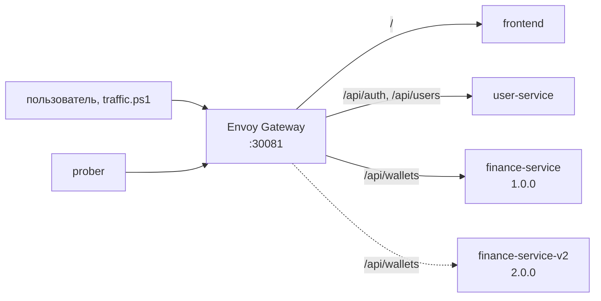

# Отчёт: стратегии развёртывания MineCoin

Работа продолжает [отчёт по Grafana](../grafana/Отчёт.md). В кластер добавлен Envoy Gateway, и через него
`finance-service` обновляется с версии `1.0.0` на `2.0.0` пятью способами: Rolling, Blue/Green, Canary, A/B и Shadow.



## 1. Изменения в приложении

Реплики, пробы и хранение состояния были сделаны раньше, в ДЗ по Kubernetes:
- у сервисов по 2 реплики;
- startup, liveness и readiness на `/actuator/health`;
- данные в PostgreSQL, вход по JWT.

Добавлена версия `finance-service`. Она задаётся при сборке образа:

```powershell
docker build -f FinanceService/Dockerfile --build-arg APP_VERSION=2.0.0 -t minecoin/finance-service:2.0.0 .
```

Где видна версия:
- `GET /api/wallets/version` (без токена) - `{"service":"finance-service","version":"1.0.0","pod":"finance-service-76f569c95-qpg6n"}`;
- заголовки `X-App-Version` и `X-Pod` в каждом ответе сервиса;
- метка `version` у всех метрик.

Файлы:
- `FinanceService/Dockerfile` - `ARG APP_VERSION`;
- `application.yml` - свойство `app.version` и метка метрик;
- новые классы в `infrastructure/web`: `ReleaseInfo`, `ReleaseConfig`, `VersionController`, `ReleaseHeaderFilter`;
- `SecurityConfig` - `/api/wallets/version` открыт без токена;
- `WalletApiIT` - тесты на эндпоинт, заголовки и метку метрик.

## 2. Envoy Gateway

Envoy Gateway v1.10.0 ставится так же, как в демо:

```powershell
kubectl apply --server-side -f https://github.com/envoyproxy/gateway/releases/download/v1.10.0/install.yaml
```

Gateway и маршруты описаны в [`60_gateway.yml`](../60_gateway.yml):

| Ресурс | Что задаёт |
|---|---|
| `EnvoyProxy minecoin` | сервис прокси `minecoin-gateway`, NodePort 30081, ресурсы прокси |
| `GatewayClass eg`, `Gateway eg` | вход в приложение, HTTP :80 |
| `HTTPRoute minecoin-web` | `/api/auth`, `/api/users` → `user-service`; `/` → `frontend` |
| `HTTPRoute finance` | `/api/wallets` → `finance-service`. Его меняют стратегии |

Отличие от демо: у прокси постоянное имя и NodePort, поэтому:
- сайт открывается по `http://<minikube ip>:30081` без `port-forward`;
- пробер ходит через Gateway и видит то же, что пользователь.

Что ещё изменено:
- [`32_finance_service.yml`](../32_finance_service.yml) - образ `1.0.0` вместо `dev`;
- [`50_prober.yml`](../50_prober.yml) - адрес пробера `http://minecoin-gateway.envoy-gateway-system.svc.cluster.local`;
- [`deploy.ps1`](../deploy.ps1) - сборка образов `1.0.0` и `2.0.0`, установка Envoy Gateway и `60_gateway.yml`.

Вторая версия - [`finance-service-v2.yml`](finance-service-v2.yml): тот же сервис с образом `2.0.0`, 2 реплики. Метка
подов `app: finance-service-v2`, чтобы они не попадали в Service `finance-service`.

## 3. Стратегии

Команды выполняются из корня репозитория. Для всех, кроме Rolling, сначала поднимается v2:

```powershell
kubectl apply -f k8s/strategies/finance-service-v2.yml
```

### Rolling

Тот же Deployment `finance-service` переходит на образ `2.0.0`, поды меняются по одному (`maxSurge: 1`,
`maxUnavailable: 0`):

```powershell
kubectl set image deployment/finance-service finance-service=minecoin/finance-service:2.0.0 -n minecoin
```

Откат:

```powershell
kubectl rollout undo deployment/finance-service -n minecoin
```

### Blue/Green

Green - текущая версия 1.0.0, blue - новая 2.0.0. Переключение и откат меняют маршрут целиком:

```powershell
kubectl apply -f k8s/strategies/blue-green/route-blue.yml
```

```powershell
kubectl apply -f k8s/strategies/blue-green/route-green.yml
```

### Canary

Веса v1/v2 меняются по шагам:

```powershell
kubectl apply -f k8s/strategies/canary/route-90-10.yml
```

```powershell
kubectl apply -f k8s/strategies/canary/route-50-50.yml
```

```powershell
kubectl apply -f k8s/strategies/canary/route-0-100.yml
```

Откат - применить файл с меньшей долей v2. Чтобы показать неудачную канарейку, в v2 можно включить ошибки из ДЗ по
SLO: `kubectl set env deployment/finance-service-v2 FAULT_ERROR_RATE=0.3 -n minecoin`.

### A/B

Запросы с заголовком `x-user-group: beta` идут на v2, остальные на v1:

```powershell
kubectl apply -f k8s/strategies/ab/route-ab.yml
```

### Shadow

Ответ пользователю даёт v1, а копия запроса уходит на v2:

```powershell
kubectl apply -f k8s/strategies/shadow/route-shadow.yml
```

Зеркалируются только GET-запросы. У v1 и v2 общая база, и копия `POST /deposit` или `/transfer` выполнилась бы на
v2 второй раз: деньги начислились бы или ушли дважды.

### Возврат в исходное состояние

```powershell
powershell -ExecutionPolicy Bypass -File k8s/strategies/reset.ps1
```

Маршрут снова ведёт на v1, `finance-service-v2` удаляется, `finance-service` возвращается на образ `1.0.0`.

## 4. Трафик, логи и дашборд

[`traffic.ps1`](traffic.ps1) шлёт запросы `GET /api/wallets/version` через Gateway и печатает версию и под каждого
ответа, а раз в 20 запросов - доли версий:

```powershell
powershell -ExecutionPolicy Bypass -File k8s/strategies/traffic.ps1 -Log canary
```

| Параметр | Что делает |
|---|---|
| `-Log <имя>` | дублирует вывод в `k8s/strategies/logs/<имя>.log` |
| `-Group beta` | добавляет заголовок `x-user-group: beta` (для A/B) |
| `-Count`, `-Interval`, `-Window` | число запросов (0 - бесконечно), пауза между ними, размер окна для долей |

Дашборд Grafana "MineCoin: стратегии деплоя"
([`deploy-strategies-dashboard.json`](../grafana/deploy-strategies-dashboard.json)) показывает по версиям:
- поды;
- долю трафика и RPS;
- ошибки 5xx и задержку;
- прогоны пробера;
- запросы по методам: для Shadow видно, что на v2 приходят только GET.

Дашборд ставится вместе с остальными через [`deploy_grafana.ps1`](../grafana/deploy_grafana.ps1).

## 5. Запуск

Из корня репозитория в PowerShell от имени администратора:

```powershell
powershell -ExecutionPolicy Bypass -File k8s/deploy.ps1
```

```powershell
powershell -ExecutionPolicy Bypass -File k8s/alerts/deploy_alerts.ps1
```

```powershell
powershell -ExecutionPolicy Bypass -File k8s/grafana/deploy_grafana.ps1
```

Адрес приложения через Gateway выводит `deploy.ps1`; его же показывает `kubectl get gateway eg -n minecoin`.

Ресурсы Envoy Gateway: контроллер 100m CPU / 256Mi, прокси 60m / 160Mi. `finance-service-v2` на время стратегий
добавляет 500m / 768Mi.
